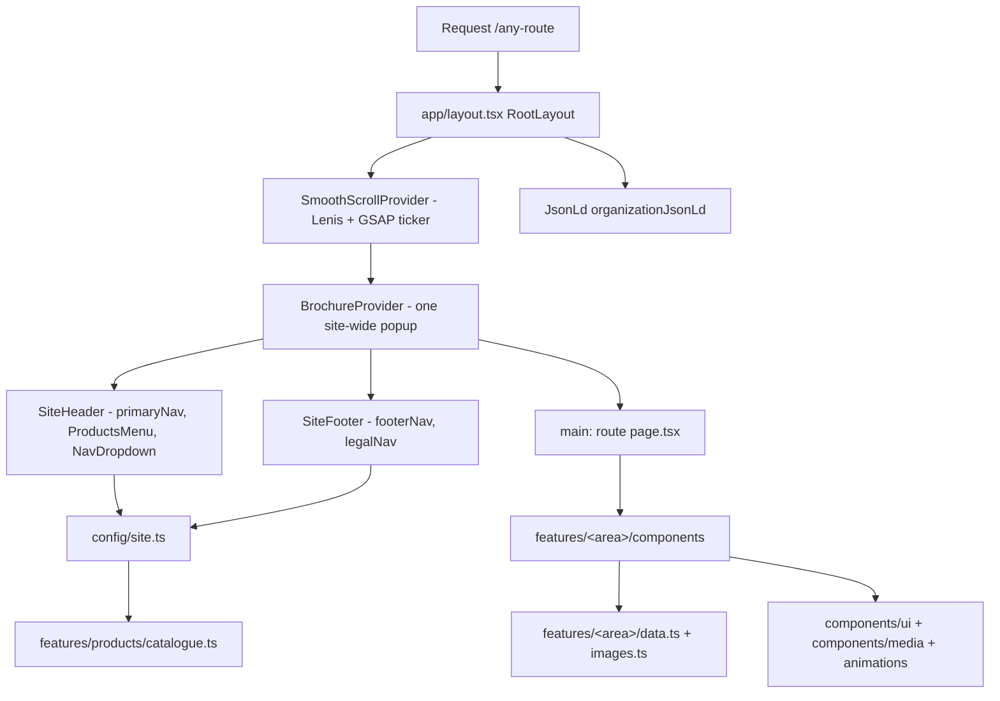
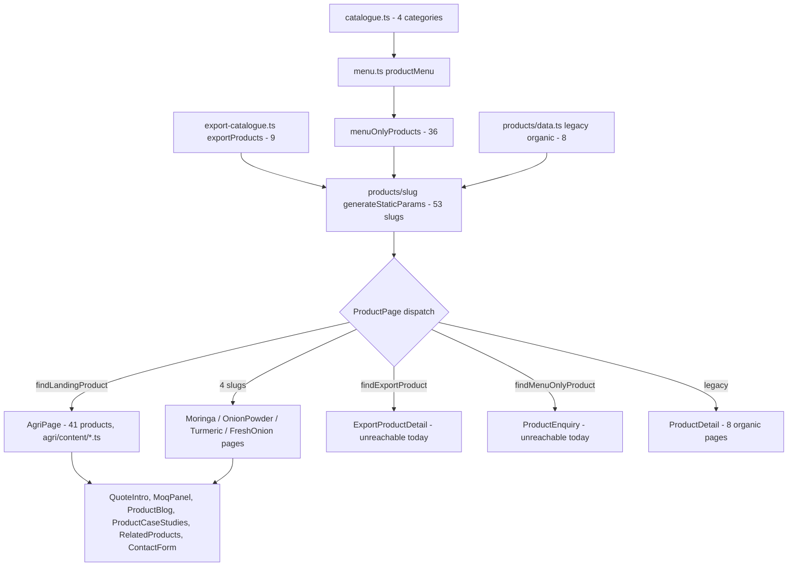
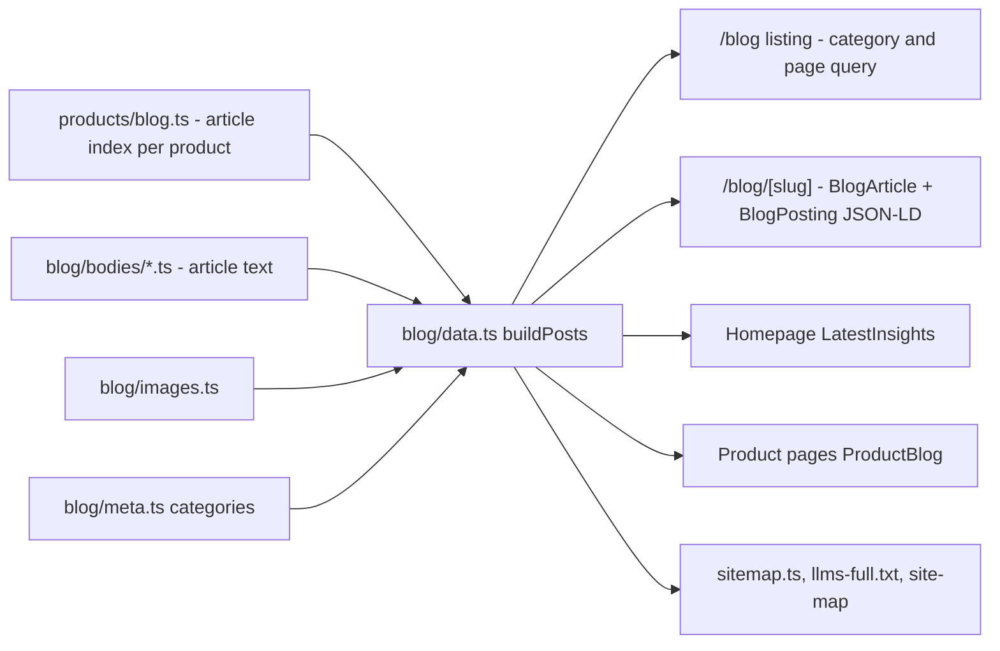
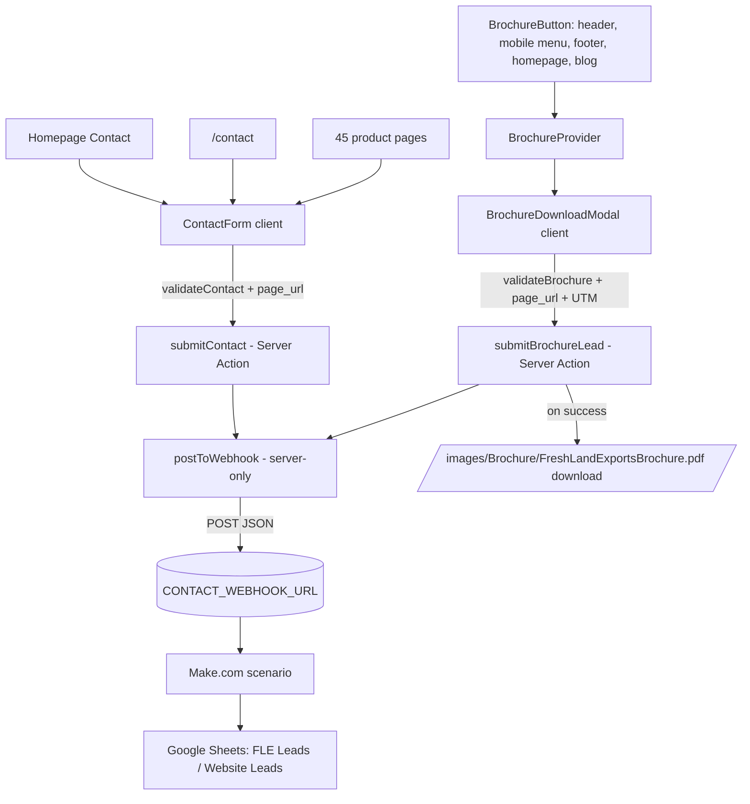
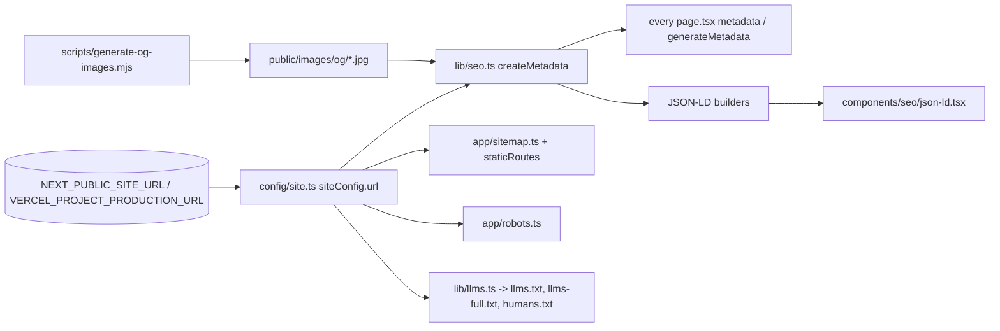
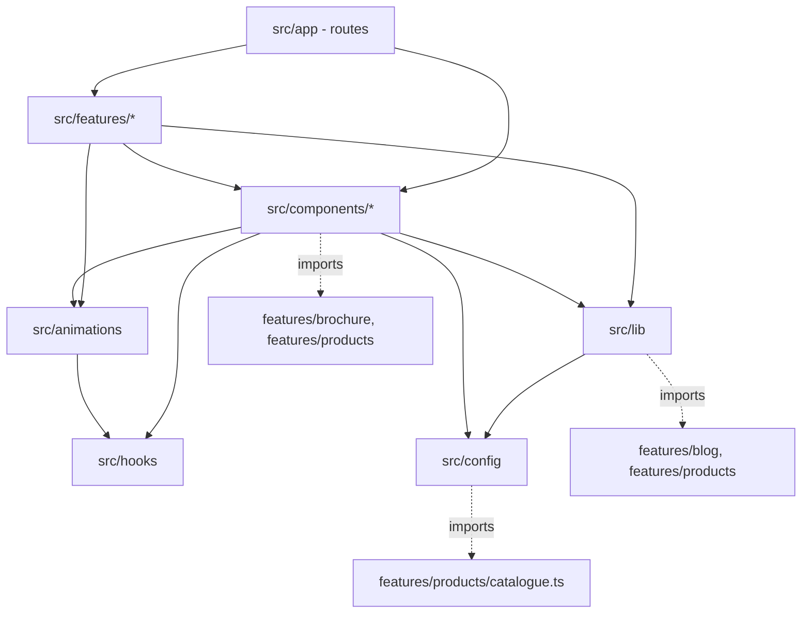

# Freshland Exports — Project Structure and Architecture

| | |
|---|---|
| **Date** | 2026-10-14 |
| **Repository** | `Freshlandexports/` (git, branch `main`). Original audit: commit `325353f`, clean working tree. **Updated for commit `01e8ee3`** (after the C1–C5 refactor). |
| **Update scope** | Only the paths, trees, importer counts and dependency notes affected by the refactor were revised (see *Update note* below). All other findings are from the original audit at `325353f` and were not re-audited. |
| **Scope** | Every folder and important file in the repository, excluding `node_modules/`, `.next/` and `.git/` internals |
| **Method** | Read-only inspection. A script outside the repo indexed all 303 code files under `src/` (304 after the refactor) (directives, exports, imports, doc comments) and built the reverse-import graph; route and render modes were read from the existing `.next` build manifests (build of 2026-10-14 14:26); no build, install or format command was run for this audit. |
| **Sizes** | `src/`: 308 files (307 at the original audit), ~44,200 lines of TypeScript/TSX/CSS. `public/`: 627 files, 184 MB. |

**Update note: C1–C5 refactor (commits `53c0503`, `3c4627a`, `c965f5a`, `01e8ee3`).** Shared code that previously lived in a single feature folder was moved to where its users are. Page output, URLs, metadata and the sitemap were verified to be unchanged after each step.

| What | Before (original audit) | Now |
|---|---|---|
| Header Products menu (`productMenu`, menu types, `dropdownIcon`) | `src/features/products/export-catalogue.ts` | `src/features/products/menu.ts` |
| Uses tabs (`UseTabs`, `UseCategory`) | `src/features/onion-powder/components/use-tabs.tsx` | `src/features/agri/components/use-tabs.tsx` |
| FAQ accordion | `src/features/moringa/components/faq-accordion.tsx` | `src/components/ui/faq-accordion.tsx` |
| Height-animated disclosure | `src/features/moringa/components/collapse.tsx` | `src/components/ui/collapse.tsx` |
| Product-page typography roles (`type`) | `src/features/moringa/styles.ts` | `src/features/products/styles.ts` |
| Image-slot data type | `MoringaImage` in `src/features/moringa/images.ts` | `ImageSlotData` in `src/features/products/types.ts` |
| `ImageSlot` component (now `slot`-only; Moringa passes `slot={moringaImages.…}`) | `src/features/moringa/components/image-slot.tsx` | `src/features/products/components/image-slot.tsx` |
| Decorative moringa leaf (`MoringaSprig`) | `src/features/moringa/components/moringa-sprig.tsx` | `src/components/media/moringa-sprig.tsx` |

---

## Table of Contents

1. [Executive Summary](#1-executive-summary)
2. [Project Overview](#2-project-overview)
3. [Technology Stack](#3-technology-stack)
4. [Complete Project Directory Tree](#4-complete-project-directory-tree)
5. [Root-Level Files Explained](#5-root-level-files-explained)
6. [Folder-by-Folder Documentation](#6-folder-by-folder-documentation)
7. [Important Files and Their Responsibilities](#7-important-files-and-their-responsibilities)
8. [Next.js Architecture](#8-nextjs-architecture)
9. [Website Routes and Page Inventory](#9-website-routes-and-page-inventory)
10. [Shared Components and Reusable Modules](#10-shared-components-and-reusable-modules)
11. [Data Flow and Integration Diagrams](#11-data-flow-and-integration-diagrams)
12. [Public Assets and Content Organization](#12-public-assets-and-content-organization)
13. [Forms and Lead Collection Architecture](#13-forms-and-lead-collection-architecture)
14. [SEO and Metadata Architecture](#14-seo-and-metadata-architecture)
15. [Configuration and Environment Variables](#15-configuration-and-environment-variables)
16. [Scripts and Development Workflow](#16-scripts-and-development-workflow)
17. [Dependencies and Relationships](#17-dependencies-and-relationships)
18. [Architectural Observations](#18-architectural-observations)
19. [Files Requiring Further Investigation](#19-files-requiring-further-investigation)
20. [Glossary of Important Technical Terms](#20-glossary-of-important-technical-terms)

---

## 1. Executive Summary

Freshland Exports is a **Next.js 16.4 App Router** marketing and lead-generation website for a B2B exporter of spices, botanical powders, fresh vegetables and fruits from India. It is written in **TypeScript (strict)**, styled with **Tailwind CSS v4** (tokens in CSS via `@theme`), and animated with **GSAP + Lenis**. There is no database, CMS, authentication or API layer: **all content is TypeScript data files inside `src/features/`**, rendered at build time into ~280 static pages. The only server-side runtime logic is two **Server Actions** that post form leads to a **Make.com webhook** (`CONTACT_WEBHOOK_URL`), which writes to Google Sheets.

How the code is organised, in one paragraph: `src/app/` holds thin route files (routing, metadata, static params); each route delegates to a **feature folder** in `src/features/<feature>/` that owns its own `data.ts` (content), `images.ts` (photo slots) and `components/`. Cross-cutting building blocks live in `src/components/` (layout shell, UI primitives, forms, media, SEO), `src/animations/` (motion layer), `src/lib/` (SEO helpers, `cn()`, analytics, llms.txt), `src/config/` (brand, navigation, feature flags) and `src/hooks/`. Photographs, the brochure PDF, OG images and the hero video are served from `public/images/`.

**Where to look first:**

| If you want to change… | Start in |
|---|---|
| Brand name, contact details, navigation, sitemap's static pages | `src/config/site.ts` |
| Which products exist, their names, images and categories | `src/features/products/catalogue.ts` |
| A product page's text and section order | `src/features/agri/content/**/<slug>.ts` (41 products) or the dedicated folders `moringa/`, `onion-powder/`, `turmeric-powder/`, `fresh-onion/` |
| How `/products/<slug>` decides which layout to use | `src/app/products/[slug]/page.tsx:108-141` |
| Blog articles | `src/features/products/blog.ts` (index) + `src/features/blog/bodies/*.ts` (text) + `src/features/blog/images.ts` |
| Case studies | `src/features/case-studies/content/*.ts` |
| Forms and lead delivery | `src/components/forms/` and `src/features/brochure/` |
| Colours, fonts, spacing tokens | `src/app/globals.css` (`@theme`, lines 10-120) |
| Page titles, Open Graph, JSON-LD | `src/lib/seo.ts` |
| Minimum order quantities | `src/features/products/moq.ts` |

**Key observations** (detail in §18):
- Four separate product lists: `catalogue.ts`, `export-catalogue.ts`, `products/data.ts` (legacy organic) and `agri/content/`.
- Shared UI that used to live inside the `moringa` feature has been moved to shared locations (C1–C5 refactor). The only remaining outside imports into `moringa/` are the product route and seven type-only `Faq` imports.
- `README.md`, `public/images/README.md` and `src/three/README.md` describe files and packages that no longer exist.
- Five modules have no importers.
- Several asset folders break the project's own lowercase-kebab-case naming rule.

---

## 2. Project Overview

| Aspect | Finding | Evidence |
|---|---|---|
| Purpose | B2B export catalogue and lead capture (quotes, enquiries, brochure downloads) | `src/config/site.ts:16-18` (tagline, description) |
| Rendering | Static generation of almost every page at build time; `/blog` listing renders per request (reads `?category=&page=`) | `.next/prerender-manifest.json` (282 prerendered entries); `src/app/blog/page.tsx:19-33` |
| Content source | TypeScript modules in `src/features/**/data.ts`, `content/`, `bodies/` — no CMS, no database, no `fetch` of content | import graph: no external data packages |
| Server logic | Two Server Actions + five route handlers (text/metadata files) | `src/components/forms/contact-action.ts`, `src/features/brochure/brochure-action.ts`; §8 |
| External integration | One outbound webhook (Make.com → Google Sheets) | `src/components/forms/webhook.ts` |
| Hosting target | Vercel is implied (`VERCEL_PROJECT_PRODUCTION_URL`, `.vercel` in `.gitignore`, comment about HSTS) but no deployment config file exists | `src/config/site.ts:24`, `.gitignore:37-38`, `next.config.ts:8` |
| Major modules | Products (catalogue + 45 product pages), Blog (141 articles), Case Studies (57), company pages (About, Farms, Knowledge Center, Certificates, FAQs, Contact, legal), Brochure lead capture | §9 |

---

## 3. Technology Stack

| Layer | Technology | Version (package.json / lockfile) | Where it is used |
|---|---|---|---|
| Framework | Next.js (App Router, Turbopack build) | `16.4.0` | `src/app/`, `next.config.ts` |
| UI library | React / React DOM | `19.2.8` | everywhere |
| Language | TypeScript, `strict: true` | `^5` | `tsconfig.json:7` |
| Styling | Tailwind CSS v4 via `@tailwindcss/postcss`; CSS-first tokens in `@theme`; two CSS Modules | `^4` | `src/app/globals.css`, `postcss.config.mjs`, `src/features/moringa/*.module.css`, `src/features/turmeric-powder/turmeric.module.css` |
| Class helpers | `clsx` + `tailwind-merge` (extended for custom font-size tokens) | `^2.1.1`, `^3.7.0` | `src/lib/utils.ts` |
| Animation | GSAP + ScrollTrigger | `^3.15.0` | `src/animations/gsap.ts` (only file importing `gsap`) |
| Smooth scroll | Lenis, driven by GSAP's ticker | `^1.3.26` | `src/components/providers/smooth-scroll-provider.tsx` |
| Fonts | `next/font/google`: Fraunces, Inter, Geist Mono | — | `src/app/layout.tsx:16-34` |
| Images | `next/image` (qualities 75 and 90 allowed) | — | 20 files; `next.config.ts:21-25` |
| Linting | ESLint 9 flat config, `eslint-config-next` (core-web-vitals + typescript) | `^9`, `16.4.0` | `eslint.config.mjs` |
| Image tooling (scripts only) | `sharp` — **not a declared dependency**; present only as an optional transitive dependency (0.35.5) | lockfile | `scripts/generate-og-images.mjs:12` |
| Package manager | **npm** (`package-lock.json`, lockfileVersion 3) | — | root |
| Testing | **None.** No test runner, no test files | — | `package.json` |
| 3D | **Not installed.** `three` / `@react-three/*` are absent from `package.json` and `node_modules` despite README claims | — | `src/three/README.md` |

---

## 4. Complete Project Directory Tree

Generated from the file system on 2026-10-14. Excluded: `node_modules/`, `.next/`, `.git/`.

### 4.1 Repository root

```text
Freshlandexports/
├── .claude/                     # Claude Code local state (scheduled_tasks.lock) — untracked tooling
├── .playwright-mcp/   (empty)   # Leftover browser-automation working folder — untracked
├── .rune/                       # Rune agent-tool metrics (tracked in git)
│   └── metrics/
│       ├── chains.jsonl
│       ├── sessions.jsonl
│       └── skills.json
├── docs/
│   └── specification-verification-record.md
├── public/                      # Static files served from "/" (see §4.3)
├── reports/                     # Audit and change reports (Markdown)
│   ├── freshland-exports-form-audit.md
│   ├── freshland-exports-message-tracking.md
│   ├── freshland-exports-project-structure.md   # this report
│   └── freshland-exports-source-tracking.md
├── scripts/
│   └── generate-og-images.mjs
├── src/                         # Application source (see §4.2)
├── .env.example
├── .gitignore
├── AGENTS.md
├── CLAUDE.md
├── dt.html
├── eslint.config.mjs
├── next-env.d.ts                # generated by Next.js, git-ignored
├── next.config.ts
├── package-lock.json
├── package.json
├── postcss.config.mjs
├── README.md
├── tsconfig.json
└── tsconfig.tsbuildinfo         # generated by tsc, git-ignored
```

Generated/ignored directories present but not documented in depth: `node_modules/` (dependencies), `.next/` (build output, including `.next/types/` which `next-env.d.ts` and `tsconfig.json` reference), `.git/`.

### 4.2 `src/` — every file

```text
src/
├── animations/
│   ├── clip-reveal.tsx
│   ├── count-up.tsx
│   ├── gsap.ts
│   ├── index.ts
│   ├── magnetic.tsx
│   ├── motion.ts
│   ├── parallax.tsx
│   ├── reveal-lines.tsx
│   ├── reveal.tsx
│   ├── scroll-scrub.tsx
│   └── tilt.tsx
├── app/
│   ├── about/
│   │   └── page.tsx
│   ├── blog/
│   │   ├── [slug]/
│   │   │   └── page.tsx
│   │   └── page.tsx
│   ├── case-studies/
│   │   ├── [slug]/
│   │   │   └── page.tsx
│   │   └── page.tsx
│   ├── certificates/
│   │   └── page.tsx
│   ├── contact/
│   │   └── page.tsx
│   ├── faqs/
│   │   └── page.tsx
│   ├── farms/
│   │   └── page.tsx
│   ├── humans.txt/
│   │   └── route.ts
│   ├── llms-full.txt/
│   │   └── route.ts
│   ├── llms.txt/
│   │   └── route.ts
│   ├── privacy-policy/
│   │   └── page.tsx
│   ├── products/
│   │   ├── [slug]/
│   │   │   └── page.tsx
│   │   └── page.tsx
│   ├── r-and-d/
│   │   └── page.tsx
│   ├── signature-ingredients/
│   │   ├── [slug]/
│   │   │   └── page.tsx
│   │   └── page.tsx
│   ├── site-map/
│   │   └── page.tsx
│   ├── terms-and-conditions/
│   │   └── page.tsx
│   ├── apple-icon.png
│   ├── error.tsx
│   ├── favicon.ico
│   ├── global-error.tsx
│   ├── globals.css
│   ├── icon.png
│   ├── layout.tsx
│   ├── manifest.ts
│   ├── not-found.tsx
│   ├── page.tsx
│   ├── robots.ts
│   └── sitemap.ts
├── components/
│   ├── forms/
│   │   ├── contact-action.ts
│   │   ├── contact-form.tsx
│   │   ├── contact-schema.ts
│   │   ├── lead-meta.ts
│   │   ├── select-fields.tsx
│   │   └── webhook.ts
│   ├── layout/
│   │   ├── nav-dropdown.tsx
│   │   ├── page-header.tsx
│   │   ├── products-menu.tsx
│   │   ├── site-footer.tsx
│   │   ├── site-header.tsx
│   │   └── skip-link.tsx
│   ├── media/
│   │   ├── botanical-art.tsx
│   │   ├── botanical-lines.tsx
│   │   ├── figure.tsx
│   │   └── moringa-sprig.tsx
│   ├── providers/
│   │   └── smooth-scroll-provider.tsx
│   ├── seo/
│   │   └── json-ld.tsx
│   └── ui/
│       ├── anchor-button.tsx
│       ├── button.tsx
│       ├── carousel.tsx
│       ├── collapse.tsx
│       ├── container.tsx
│       ├── eyebrow.tsx
│       ├── faq-accordion.tsx
│       ├── icon.tsx
│       ├── logo.tsx
│       ├── modal.tsx
│       ├── ornament.tsx
│       ├── ruled-eyebrow.tsx
│       ├── section.tsx
│       └── wave-divider.tsx
├── config/
│   ├── features.ts
│   └── site.ts
├── features/
│   ├── about/
│   │   ├── components/
│   │   │   ├── about-hero.tsx
│   │   │   ├── core-values.tsx
│   │   │   ├── hero-panels.tsx
│   │   │   ├── our-story.tsx
│   │   │   ├── vision-mission.tsx
│   │   │   └── why-choose.tsx
│   │   └── data.ts
│   ├── agri/
│   │   ├── components/
│   │   │   ├── agri-page.tsx
│   │   │   ├── contact.tsx
│   │   │   ├── details.tsx
│   │   │   ├── extras.tsx
│   │   │   ├── hero.tsx
│   │   │   ├── intro-features.tsx
│   │   │   ├── shared.tsx
│   │   │   ├── use-tabs.tsx
│   │   │   └── uses.tsx
│   │   ├── content/
│   │   │   ├── fruits/
│   │   │   │   ├── banana.ts
│   │   │   │   ├── chikoo.ts
│   │   │   │   ├── grapes.ts
│   │   │   │   ├── guava.ts
│   │   │   │   ├── helpers.ts
│   │   │   │   ├── mango.ts
│   │   │   │   ├── orange.ts
│   │   │   │   ├── papaya.ts
│   │   │   │   └── pomegranate.ts
│   │   │   ├── powders/
│   │   │   │   ├── black-pepper-powder.ts
│   │   │   │   ├── clove-powder.ts
│   │   │   │   ├── coriander-seeds-powder.ts
│   │   │   │   ├── dry-ginger-powder.ts
│   │   │   │   ├── dry-mango-powder.ts
│   │   │   │   ├── garam-masala.ts
│   │   │   │   ├── garlic-powder.ts
│   │   │   │   ├── helpers.ts
│   │   │   │   ├── nutmeg-powder.ts
│   │   │   │   ├── red-chilli-powder.ts
│   │   │   │   └── white-pepper-powder.ts
│   │   │   ├── spices/
│   │   │   │   ├── black-pepper.ts
│   │   │   │   ├── cinnamon.ts
│   │   │   │   ├── cloves.ts
│   │   │   │   ├── coriander-seeds.ts
│   │   │   │   ├── cumin-seeds.ts
│   │   │   │   ├── fennel-seeds.ts
│   │   │   │   ├── fenugreek-seeds.ts
│   │   │   │   ├── green-cardamom.ts
│   │   │   │   ├── helpers.ts
│   │   │   │   ├── mustard-seeds.ts
│   │   │   │   ├── psyllium-seed.ts
│   │   │   │   ├── red-chilli.ts
│   │   │   │   └── turmeric.ts
│   │   │   ├── beans.ts
│   │   │   ├── bitter-gourd.ts
│   │   │   ├── cabbage.ts
│   │   │   ├── cucumber.ts
│   │   │   ├── drumstick.ts
│   │   │   ├── eggplant.ts
│   │   │   ├── elephant-yam.ts
│   │   │   ├── frozen-peas.ts
│   │   │   ├── garlic.ts
│   │   │   ├── green-chili.ts
│   │   │   ├── helpers.ts
│   │   │   ├── index.ts
│   │   │   ├── okra.ts
│   │   │   └── photo-credits.ts
│   │   └── types.ts
│   ├── blog/
│   │   ├── bodies/
│   │   │   ├── fruits.ts
│   │   │   ├── powders-a.ts
│   │   │   ├── powders-b.ts
│   │   │   ├── powders-c.ts
│   │   │   ├── powders-d.ts
│   │   │   ├── spices-a.ts
│   │   │   ├── spices-b.ts
│   │   │   ├── spices-c.ts
│   │   │   └── vegetables.ts
│   │   ├── components/
│   │   │   ├── article-toc.tsx
│   │   │   ├── blog-article.tsx
│   │   │   ├── blog-card.tsx
│   │   │   ├── blog-listing.tsx
│   │   │   ├── blog-section.tsx
│   │   │   ├── brochure-card.tsx
│   │   │   └── sticky-sidebar.tsx
│   │   ├── data.ts
│   │   ├── images.ts
│   │   └── meta.ts
│   ├── brochure/
│   │   ├── brochure-action.ts
│   │   ├── brochure-button.tsx
│   │   ├── brochure-modal.tsx
│   │   ├── brochure-provider.tsx
│   │   └── schema.ts
│   ├── case-studies/
│   │   ├── components/
│   │   │   ├── case-study-browser.tsx
│   │   │   ├── case-study-card.tsx
│   │   │   ├── case-study-detail.tsx
│   │   │   ├── product-case-studies.tsx
│   │   │   └── share-buttons.tsx
│   │   ├── content/
│   │   │   ├── agricultural.ts
│   │   │   ├── fruits.ts
│   │   │   ├── powders.ts
│   │   │   └── spices.ts
│   │   ├── card-data.ts
│   │   └── data.ts
│   ├── categories/
│   │   └── types.ts
│   ├── certificates/
│   │   ├── components/
│   │   │   ├── certificate-card.tsx
│   │   │   └── certificates-grid.tsx
│   │   └── data.ts
│   ├── contact/
│   │   └── components/
│   │       └── contact-backdrop.tsx
│   ├── faqs/
│   │   └── data.ts
│   ├── farms/
│   │   ├── components/
│   │   │   ├── agricultural-network.tsx
│   │   │   ├── farm-arches.tsx
│   │   │   ├── farms-cta.tsx
│   │   │   ├── farms-hero.tsx
│   │   │   ├── our-approach.tsx
│   │   │   ├── our-promise.tsx
│   │   │   ├── our-roots.tsx
│   │   │   └── people-behind.tsx
│   │   └── data.ts
│   ├── fresh-onion/
│   │   ├── components/
│   │   │   ├── fresh-onion-about.tsx
│   │   │   ├── fresh-onion-contact.tsx
│   │   │   ├── fresh-onion-faq.tsx
│   │   │   ├── fresh-onion-features.tsx
│   │   │   ├── fresh-onion-hero.tsx
│   │   │   ├── fresh-onion-page.tsx
│   │   │   ├── fresh-onion-specs.tsx
│   │   │   └── fresh-onion-uses.tsx
│   │   ├── data.ts
│   │   └── images.ts
│   ├── home/
│   │   ├── components/
│   │   │   ├── brand-story.tsx
│   │   │   ├── brochure-cta.tsx
│   │   │   ├── certification-marquee.tsx
│   │   │   ├── contact.tsx
│   │   │   ├── featured-products.tsx
│   │   │   ├── hero-video.tsx
│   │   │   ├── hero.tsx
│   │   │   ├── home-case-studies.tsx
│   │   │   ├── home-faq.tsx
│   │   │   ├── latest-insights.tsx
│   │   │   ├── product-categories.tsx
│   │   │   └── sustainability.tsx
│   │   └── data.ts
│   ├── legal/
│   │   ├── components/
│   │   │   └── legal-page.tsx
│   │   ├── photo-credits.ts
│   │   ├── privacy-policy.ts
│   │   ├── terms.ts
│   │   └── types.ts
│   ├── moringa/
│   │   ├── components/
│   │   │   ├── moringa-about.tsx
│   │   │   ├── moringa-applications.tsx
│   │   │   ├── moringa-cta.tsx
│   │   │   ├── moringa-details.tsx
│   │   │   ├── moringa-faq.tsx
│   │   │   ├── moringa-hero.tsx
│   │   │   ├── moringa-nutrients.tsx
│   │   │   ├── moringa-page.tsx
│   │   │   ├── moringa-process.module.css
│   │   │   ├── moringa-process.tsx
│   │   │   ├── moringa-recipes.tsx
│   │   │   ├── orbit-badge.tsx
│   │   │   └── recipe-details.tsx
│   │   ├── data.ts
│   │   ├── images.ts
│   │   └── moringa.module.css
│   ├── onion-powder/
│   │   ├── components/
│   │   │   ├── onion-applications.tsx
│   │   │   ├── onion-contact.tsx
│   │   │   ├── onion-faq.tsx
│   │   │   ├── onion-hero.tsx
│   │   │   ├── onion-overview.tsx
│   │   │   ├── onion-page.tsx
│   │   │   ├── onion-process.tsx
│   │   │   ├── onion-rings.tsx
│   │   │   ├── onion-specs.tsx
│   │   │   └── onion-storage.tsx
│   │   ├── data.ts
│   │   └── images.ts
│   ├── products/
│   │   ├── components/
│   │   │   ├── category-nav.tsx
│   │   │   ├── export-product-detail.tsx
│   │   │   ├── export-range.tsx
│   │   │   ├── image-slot.tsx
│   │   │   ├── moq-panel.tsx
│   │   │   ├── product-blog.tsx
│   │   │   ├── product-catalogue.tsx
│   │   │   ├── product-detail.tsx
│   │   │   ├── product-enquiry.tsx
│   │   │   ├── product-grid.tsx
│   │   │   ├── products-hero.tsx
│   │   │   ├── products-quote-cta.tsx
│   │   │   ├── quote-intro.tsx
│   │   │   └── related-products.tsx
│   │   ├── blog.ts
│   │   ├── catalogue.ts
│   │   ├── data.ts
│   │   ├── export-catalogue.ts
│   │   ├── export-images.ts
│   │   ├── menu.ts
│   │   ├── moq.ts
│   │   ├── styles.ts
│   │   └── types.ts
│   ├── r-and-d/
│   │   ├── components/
│   │   │   ├── about-research.tsx
│   │   │   ├── lab-gallery.tsx
│   │   │   ├── rd-hero.tsx
│   │   │   ├── research-capabilities.tsx
│   │   │   ├── research-focus.tsx
│   │   │   └── research-notes.tsx
│   │   └── data.ts
│   ├── signature-ingredients/
│   │   ├── components/
│   │   │   ├── brand-philosophy.tsx
│   │   │   ├── cinematic-frame.tsx
│   │   │   ├── featured-ingredients.tsx
│   │   │   ├── ingredient-detail.tsx
│   │   │   ├── ingredient-grid.tsx
│   │   │   ├── ingredient-navigation.tsx
│   │   │   ├── ingredients-cta.tsx
│   │   │   └── signature-ingredients-hero.tsx
│   │   └── data.ts
│   ├── site-map/
│   │   ├── components/
│   │   │   └── site-map-tree.tsx
│   │   └── data.ts
│   └── turmeric-powder/
│       ├── components/
│       │   ├── turmeric-about.tsx
│       │   ├── turmeric-applications.tsx
│       │   ├── turmeric-contact.tsx
│       │   ├── turmeric-details.tsx
│       │   ├── turmeric-hero.tsx
│       │   ├── turmeric-page.tsx
│       │   └── turmeric-sun.tsx
│       ├── data.ts
│       ├── images.ts
│       └── turmeric.module.css
├── hooks/
│   ├── use-isomorphic-layout-effect.ts
│   ├── use-reduced-motion.ts
│   └── use-section-motion.ts
├── lib/
│   ├── analytics.ts
│   ├── llms.ts
│   ├── seo.ts
│   └── utils.ts
├── three/
│   └── README.md
└── types/
    ├── index.ts
    └── media.ts
```

**Empty directories in `src/`:** none.

### 4.3 `public/` — every directory (files capped at four per folder)

Every directory is shown. Folders with more than four files list the first four alphabetically, then a count of the rest. Asset groups are summarised in §12.

```text
public/
├── images/
│   ├── 404Img/
│   │   └── 404Bg image.webp
│   ├── about/
│   │   ├── .gitkeep
│   │   ├── about-hero-botanical-plant.webp
│   │   ├── about-hero-dried-red-spices.webp
│   │   ├── about-hero-farmland-sunset.webp
│   │   └── … 5 more image files
│   ├── Blog/
│   │   ├── Guide/
│   │   │   └── Guide.webp
│   │   ├── banana-export-guide-finger-length-grade-and-maturity.webp
│   │   ├── bitter-gourd-in-asian-cooking-and-juices.webp
│   │   ├── bitter-gourd-quality-ridges-colour-and-firmness.webp
│   │   ├── black-pepper-powder-in-seasonings-meat-products-and-ready-meals.webp
│   │   └── … 102 more image files
│   ├── Brochure/
│   │   └── FreshLandExportsBrochure.pdf
│   ├── categories/
│   │   └── .gitkeep
│   ├── certificates/
│   │   ├── APEDA.png
│   │   ├── Certificate-page-hero-bg.webp
│   │   ├── EU Organic.png
│   │   ├── FIEO.png
│   │   └── … 9 more image files
│   ├── dropdown-menu-icons/
│   │   ├── Banana.webp
│   │   ├── Beans.webp
│   │   ├── Bitter Gourd.webp
│   │   ├── Black Pepper.webp
│   │   └── … 33 more image files
│   ├── farms/
│   │   ├── .gitkeep
│   │   ├── agricultural-network-global-farms.webp
│   │   ├── agricultural-network-indian-farm.webp
│   │   ├── farmer-cultivating-crops.webp
│   │   └── … 10 more image files
│   ├── home/
│   │   ├── Bg video/
│   │   │   └── freshland-exports-hero-background.webm
│   │   ├── categories/
│   │   │   ├── .gitkeep
│   │   │   ├── Agriculturalproduct.webp
│   │   │   ├── botanical-extracts.webp
│   │   │   ├── Botanicalpowder.webp
│   │   │   └── … 3 more image files
│   │   ├── contact/
│   │   │   ├── .gitkeep
│   │   │   └── contact-world-map.webp
│   │   ├── hero/
│   │   │   ├── .gitkeep
│   │   │   ├── APEDA.png
│   │   │   ├── EU Organic.png
│   │   │   ├── FIEO.png
│   │   │   └── … 16 more image files
│   │   ├── products/
│   │   │   ├── .gitkeep
│   │   │   ├── black-pepper-powder.webp
│   │   │   ├── clove-powder.webp
│   │   │   ├── coriander-seeds-powder.webp
│   │   │   └── … 15 more image files
│   │   ├── story/
│   │   │   ├── .gitkeep
│   │   │   ├── across-the-world.webp
│   │   │   └── botanical-science.webp
│   │   ├── sustainability/
│   │   │   ├── .gitkeep
│   │   │   └── sustainable-farmland.webp
│   │   └── .gitkeep
│   ├── og/
│   │   ├── about.jpg
│   │   ├── blog.jpg
│   │   ├── case-studies.jpg
│   │   ├── certificates.jpg
│   │   └── … 7 more image files
│   ├── products/
│   │   ├── agri/
│   │   │   ├── banana/
│   │   │   │   ├── banana-detail.webp
│   │   │   │   └── banana-hero.webp
│   │   │   ├── beans/
│   │   │   │   ├── beans-blanched.webp
│   │   │   │   ├── beans-bowl.webp
│   │   │   │   ├── beans-detail.webp
│   │   │   │   └── beans-hero.webp
│   │   │   ├── bitter-gourd/
│   │   │   │   ├── bitter-gourd-detail.webp
│   │   │   │   └── bitter-gourd-hero.webp
│   │   │   ├── chikoo/
│   │   │   │   ├── chikoo-detail.webp
│   │   │   │   └── chikoo-hero.webp
│   │   │   ├── drumstick/
│   │   │   │   ├── drumstick-hero.webp
│   │   │   │   ├── drumstick-use-curry.webp
│   │   │   │   ├── drumstick-use-frozen.webp
│   │   │   │   ├── drumstick-use-sambar.webp
│   │   │   │   └── … 1 more image files
│   │   │   ├── eggplant/
│   │   │   │   ├── eggplant-detail.webp
│   │   │   │   └── eggplant-hero.webp
│   │   │   ├── frozen-peas/
│   │   │   │   ├── frozen-peas-detail.webp
│   │   │   │   ├── frozen-peas-hero.webp
│   │   │   │   ├── frozen-peas-pods.webp
│   │   │   │   └── frozen-peas-scoop.webp
│   │   │   ├── grapes/
│   │   │   │   ├── grapes-detail.webp
│   │   │   │   ├── grapes-green.webp
│   │   │   │   └── grapes-hero.webp
│   │   │   ├── guava/
│   │   │   │   ├── guava-detail.webp
│   │   │   │   ├── guava-hero.webp
│   │   │   │   ├── guava-slice.webp
│   │   │   │   └── guava-white.webp
│   │   │   ├── mango/
│   │   │   │   ├── mango-hero.webp
│   │   │   │   ├── mango-use-desserts.webp
│   │   │   │   ├── mango-use-drinks.webp
│   │   │   │   ├── mango-use-fresh.webp
│   │   │   │   └── … 1 more image files
│   │   │   ├── okra/
│   │   │   │   ├── okra-hero.webp
│   │   │   │   ├── okra-use-curry.webp
│   │   │   │   ├── okra-use-fried.webp
│   │   │   │   ├── okra-use-frozen.webp
│   │   │   │   └── … 1 more image files
│   │   │   ├── orange/
│   │   │   │   ├── orange-detail.webp
│   │   │   │   ├── orange-hero.webp
│   │   │   │   ├── orange-slice.webp
│   │   │   │   └── orange-tree.webp
│   │   │   ├── papaya/
│   │   │   │   ├── papaya-detail.webp
│   │   │   │   ├── papaya-hero.webp
│   │   │   │   ├── papaya-use-drinks.webp
│   │   │   │   ├── papaya-use-fresh.webp
│   │   │   │   └── … 2 more image files
│   │   │   └── pomegranate/
│   │   │       ├── pomegranate-detail.webp
│   │   │       ├── pomegranate-hero.webp
│   │   │       ├── pomegranate-use-fresh.webp
│   │   │       ├── pomegranate-use-juice.webp
│   │   │       └── … 2 more image files
│   │   ├── Agricultural Products/
│   │   │   ├── Cabbage/
│   │   │   │   ├── cabbage-export-quality.webp
│   │   │   │   ├── fresh-cabbage-cooked-dishes.webp
│   │   │   │   ├── fresh-cabbage-fermented.webp
│   │   │   │   ├── fresh-cabbage-food-processing.webp
│   │   │   │   └── … 4 more image files
│   │   │   ├── Cucumber/
│   │   │   │   ├── cucumber-export-quality.webp
│   │   │   │   ├── fresh-cucumber-beverages.webp
│   │   │   │   ├── fresh-cucumber-hero.webp
│   │   │   │   ├── fresh-cucumber-pickling.webp
│   │   │   │   └── … 5 more image files
│   │   │   ├── Elephant Yam/
│   │   │   │   ├── elephant-yam-bulk-quality.webp
│   │   │   │   ├── elephant-yam-culinary-applications.webp
│   │   │   │   └── elephant-yam-hero.webp
│   │   │   ├── Garlic/
│   │   │   │   ├── fresh-garlic-bulbs-quality.webp
│   │   │   │   ├── fresh-garlic-hero.webp
│   │   │   │   └── garlic-bulk-sourcing-quality.webp
│   │   │   ├── Green Chili/
│   │   │   │   ├── green-chilli-applications.webp
│   │   │   │   ├── green-chilli-export-quality.webp
│   │   │   │   └── green-chilli-hero.webp
│   │   │   └── Onion/
│   │   │       ├── fresh-onion-quality-inspection.webp
│   │   │       ├── fresh-onion-selection.webp
│   │   │       ├── fresh-onion-storage-handling.webp
│   │   │       ├── fresh-onions-culinary.webp
│   │   │       └── … 4 more image files
│   │   ├── Black pepper powder/
│   │   │   ├── black-pepper-application-meat.webp
│   │   │   ├── black-pepper-application-soup.webp
│   │   │   ├── black-pepper-aroma.webp
│   │   │   ├── black-pepper-bulk-packaging.webp
│   │   │   └── … 22 more image files
│   │   ├── Coriander Powder/
│   │   │   ├── application-curry.webp
│   │   │   ├── application-sauce.webp
│   │   │   ├── application-seasoning.webp
│   │   │   ├── application-spice-blend.webp
│   │   │   └── … 10 more image files
│   │   ├── Fruits/   (empty)
│   │   ├── GreenChillies/
│   │   │   ├── Fresh Green Chilli Sorting Display.png
│   │   │   ├── green-chilli-export-quality.png
│   │   │   └── green-chilli-hero.webp
│   │   ├── Moringa Powder/
│   │   │   ├── moringa-breakfast-bowl.webp
│   │   │   ├── moringa-drink.webp
│   │   │   ├── moringa-farm-background.webp
│   │   │   ├── moringa-fresh-leaves.webp
│   │   │   └── … 25 more image files
│   │   ├── Onion Powder/
│   │   │   ├── fresh-onions-powder.webp
│   │   │   ├── onion-powder-culinary-uses.webp
│   │   │   ├── onion-powder-hero.webp
│   │   │   └── onion-powder-industrial-processing.webp
│   │   ├── Powder Product/
│   │   │   ├── Dry Mango Powder/
│   │   │   │   ├── dry-mango-powder-bulk-packaging.webp
│   │   │   │   ├── dry-mango-powder-culinary-applications.webp
│   │   │   │   ├── dry-mango-powder-food-manufacturing-case-study.webp
│   │   │   │   ├── dry-mango-powder-food-manufacturing.webp
│   │   │   │   └── … 8 more image files
│   │   │   ├── Garam masala Powder/
│   │   │   │   ├── Garam Masala Spice Bowl and Whole Spices.webp
│   │   │   │   ├── Garam- masala-rice.webp
│   │   │   │   ├── garam-masala-blend-composition.webp
│   │   │   │   ├── garam-masala-bulk-packaging.webp
│   │   │   │   └── … 16 more image files
│   │   │   ├── Nutmeg Powder/
│   │   │   │   ├── nutmeg-bakery-case-study.webp
│   │   │   │   ├── nutmeg-benefits-blog.webp
│   │   │   │   ├── nutmeg-bulk-packaging..webp
│   │   │   │   ├── nutmeg-culinary-applications.webp
│   │   │   │   └── … 10 more image files
│   │   │   └── Red Chilli Powder/
│   │   │       ├── red-chilli-powder-applications.webp
│   │   │       ├── red-chilli-powder-bulk-supply.webp
│   │   │       ├── red-chilli-powder-commercial-buyers.webp
│   │   │       ├── red-chilli-powder-hero.webp
│   │   │       └── … 7 more image files
│   │   ├── powders/
│   │   │   ├── black-pepper-powder-applications.webp
│   │   │   ├── black-pepper-powder-hero.webp
│   │   │   ├── black-pepper-powder-seasoning.webp
│   │   │   ├── black-pepper-powder-texture.webp
│   │   │   └── … 19 more image files
│   │   ├── spices/
│   │   │   ├── black-pepper-culinary-use.webp
│   │   │   ├── black-pepper-hero.webp
│   │   │   ├── black-pepper-vine.webp
│   │   │   ├── cinnamon-applications.webp
│   │   │   └── … 37 more image files
│   │   ├── Spices/   (empty)
│   │   ├── Turmeric Powder/
│   │   │   ├── turmeric-powder-food-applications.webp
│   │   │   ├── turmeric-powder-hero.webp
│   │   │   ├── turmeric-powder-insights.webp
│   │   │   └── turmeric-roots-powder.webp
│   │   ├── .gitkeep
│   │   ├── Banana.webp
│   │   ├── Beans.webp
│   │   ├── Bitter Gourd.webp
│   │   └── … 48 more image files
│   ├── quality/
│   │   └── .gitkeep
│   ├── r-and-d/
│   │   ├── .gitkeep
│   │   ├── botanical-sourcing-quality.webp
│   │   ├── natural-ingredient-stability.webp
│   │   ├── plant-extraction-methods.webp
│   │   └── … 9 more image files
│   ├── resources/
│   │   └── .gitkeep
│   ├── Resources/
│   │   └── Blog/
│   │       └── freshland-exports-blog-card.webp
│   ├── shared/
│   │   ├── decorative/
│   │   │   └── .gitkeep
│   │   ├── icons/
│   │   │   └── .gitkeep
│   │   ├── logos/
│   │   │   ├── .gitkeep
│   │   │   ├── FreshLand-Exports-Logo.png
│   │   │   └── freshland-mark.png
│   │   ├── og/
│   │   │   └── .gitkeep
│   │   ├── .gitkeep
│   │   └── brochure-cover.webp
│   ├── signature ingredients/
│   │   ├── ashwalite-featured.webp
│   │   ├── ashwalite-roots.webp
│   │   ├── cinaplus-cinnamon.webp
│   │   ├── fenugreek-seeds.webp
│   │   └── … 5 more image files
│   ├── .gitkeep
│   └── README.md
├── FreshLand-Exports-Logo.svg
└── FreshLand-Exports-Logo1.svg
```

**Empty directories in `public/`:** `images/products/Fruits/` and `images/products/Spices/` hold no files at all. Six more folders contain only a `.gitkeep` placeholder: `images/categories/`, `images/quality/`, `images/resources/`, `images/shared/decorative/`, `images/shared/icons/` and `images/shared/og/`.

---

## 5. Root-Level Files Explained

| File | Type | Purpose | Notes / what breaks if changed |
|---|---|---|---|
| `package.json` | npm manifest | Name `freshland-exports`, version 0.1.0, `private`; 7 runtime and 8 dev dependencies; scripts (§16) | Description still says "certified organic botanical house" (line 33), which no longer matches the site's positioning. |
| `package-lock.json` | npm lockfile v3 | Pins exact dependency tree (e.g. `next` 16.4.0 at line 5324) | Never hand-edit; regenerate with `npm install`. |
| `next.config.ts` | Next.js config (TS) | Security headers on all routes (lines 10-20); allowed image qualities `[75, 90]` (21-25); permanent redirects for retitled blog articles and the old `/resources` paths (26-46); temporary redirects of `/signature-ingredients/*` to `/products` while `featureFlags.signatureIngredients` is false (47-55) | Imports `src/config/features.ts` — that file must stay import-free. No CSP yet (comment line 6-8). |
| `tsconfig.json` | TypeScript config | Strict mode, `moduleResolution: bundler`, `@/*` → `./src/*` path alias (lines 21-23), includes `.next/types` for typed routes | Changing the alias breaks every `@/` import (all 304 files). |
| `next-env.d.ts` | Generated | References Next types and `.next/types/routes.d.ts` | Git-ignored; "should not be edited". |
| `eslint.config.mjs` | ESLint 9 flat config | `eslint-config-next` core-web-vitals + TypeScript presets; ignores `.next`, `out`, `build`, `next-env.d.ts` | `npm run lint` uses it. |
| `postcss.config.mjs` | PostCSS config | Single plugin `@tailwindcss/postcss` — the Tailwind v4 integration | There is no `tailwind.config.*`; Tailwind v4 reads tokens from `globals.css`. |
| `.env.example` | Env template | Documents `NEXT_PUBLIC_SITE_URL` and `CONTACT_WEBHOOK_URL` (§15) | The only env file in the repo; `.env*` is git-ignored except this one. |
| `.gitignore` | Git | Ignores `node_modules`, `.next`, `out`, `build`, `.env*` (except example), `.vercel`, `*.tsbuildinfo`, `next-env.d.ts`, `*.local` | Does **not** ignore `.claude/`, `.playwright-mcp/` or `.rune/`. |
| `README.md` | Docs | Stack, scripts, folder overview, design-system, motion and SEO notes | **Partly outdated** (§18.6). |
| `AGENTS.md` | AI-agent instructions | Written by `next dev`: warns that Next.js 16 APIs differ from older versions and points to `node_modules/next/dist/docs/` | Regenerated by `next dev`. |
| `CLAUDE.md` | AI-agent instructions | One line: `@AGENTS.md` (includes it) | — |
| `dt.html` | Stray HTML (tracked) | An "Access Denied" error page saved from a USDA APHIS URL — not served (outside `public/`), not referenced | Candidate for removal (§19). |
| `tsconfig.tsbuildinfo` | Generated | Incremental TypeScript cache | Git-ignored. |

---

## 6. Folder-by-Folder Documentation

Legend for **Kind**: Code = application code · Content = data/content modules · Config · Assets · Docs · Tooling · Generated.

### 6.1 Top-level folders

| Folder | Kind | Responsibility | Depended on by |
|---|---|---|---|
| `src/` | Code | The whole application (§6.2 onwards) | Next.js build |
| `public/` | Assets | Files served verbatim from `/` — photographs, brochure PDF, OG cards, hero video, logos | Code references `/images/...` paths (§12) |
| `scripts/` | Tooling | `generate-og-images.mjs` — builds the 1200×630 social cards in `public/images/og/` with `sharp` | `src/lib/seo.ts` (`ogCard()`) reads its output |
| `docs/` | Docs | `specification-verification-record.md` (152 lines): internal record of which product-specification rows were removed and why (no confirmed company specs) | Humans only; not linked from the site |
| `reports/` | Docs | Audit/change reports (form audit, source tracking, message tracking, this report) | Humans only |
| `.rune/` | Tooling | Metrics from the Rune agent toolkit (`sessions.jsonl`, `skills.json`, `chains.jsonl`) — tracked in git, changes every session | Nothing in the app |
| `.claude/` | Tooling | Claude Code lock file | Nothing in the app |
| `.playwright-mcp/` | Tooling | Empty folder left by a browser-automation tool | Nothing |

### 6.2 `src/app/` — routes (App Router)

**Kind:** Code. **Responsibility:** URL structure, page-level metadata, static params, error/not-found boundaries, metadata routes (sitemap, robots, manifest, icons) and text route handlers. Route files are thin: they read a feature's data and render that feature's components.

| Subfolder / file | Responsibility |
|---|---|
| `layout.tsx`, `globals.css` | Root layout (fonts, providers, header/footer, organisation JSON-LD) and the global design system |
| `page.tsx` | Homepage composition |
| `about/`, `farms/`, `r-and-d/`, `certificates/`, `faqs/`, `contact/`, `privacy-policy/`, `terms-and-conditions/`, `site-map/` | One static page each |
| `products/`, `products/[slug]/` | Catalogue listing and every product page |
| `blog/`, `blog/[slug]/` | Blog listing (dynamic, query-driven) and 141 articles |
| `case-studies/`, `case-studies/[slug]/` | Case-study browser and 57 studies |
| `signature-ingredients/`, `signature-ingredients/[slug]/` | Hidden behind a feature flag (redirected); still prerendered |
| `humans.txt/`, `llms.txt/`, `llms-full.txt/` | Route handlers returning generated plain text/Markdown |
| `sitemap.ts`, `robots.ts`, `manifest.ts`, `icon.png`, `apple-icon.png`, `favicon.ico` | Metadata file conventions |
| `error.tsx`, `global-error.tsx`, `not-found.tsx` | Error and 404 UI |

### 6.3 `src/components/` — shared, feature-agnostic UI

| Subfolder | Kind | Contents | Used by |
|---|---|---|---|
| `components/layout/` | Code | Site shell: `site-header.tsx` (client; sticky header, mobile menu, Brochure/Get a Quote buttons), `products-menu.tsx` (Products mega-menu), `nav-dropdown.tsx` (Resources dropdown), `site-footer.tsx`, `skip-link.tsx`, `page-header.tsx` (interior masthead) | `app/layout.tsx`; `page-header` by `/faqs` and ingredient detail |
| `components/ui/` | Code | Design-system primitives: `container`, `section`, `button` (+`CircleButton`), `anchor-button`, `icon` (inline SVG set), `eyebrow`, `ruled-eyebrow`, `logo`, `modal`, `carousel`, `ornament`, `wave-divider`, `faq-accordion` (client; one-open-at-a-time accordion), `collapse` (height-animated disclosure) | Almost every feature; `container` 90 importers, `icon` 62, `button` 34; `faq-accordion` 7 (`/faqs`, homepage, every product-page FAQ) |
| `components/forms/` | Code | Lead forms: `contact-form.tsx`, `contact-schema.ts`, `contact-action.ts` (Server Action), `select-fields.tsx` (custom dropdowns), `lead-meta.ts` (`page_url`), `webhook.ts` (server-only delivery) | Product pages, homepage, `/contact`; brochure feature reuses `select-fields`, `lead-meta`, `webhook` |
| `components/media/` | Code | `figure.tsx` (every photographic slot; falls back to generated art), `botanical-art.tsx` (SVG placeholder art), `botanical-lines.tsx` (decorative line art), `moringa-sprig.tsx` (decorative moringa leaf, also used by `ImageSlot` placeholders and the `/contact` backdrop) | 37 / 6 / 12 / 9 importers |
| `components/providers/` | Code | `smooth-scroll-provider.tsx`: the single Lenis instance and `useSmoothScroll()` context | Root layout; header, anchor buttons, TOC, category nav |
| `components/seo/` | Code | `json-ld.tsx`: `JsonLd` (escaped `<script type="application/ld+json">`) and `FaqJsonLd` | 12 files |

### 6.4 `src/features/` — one folder per site area

Each feature typically contains `data.ts` (copy), optional `images.ts` (photo slots), `components/` and sometimes `types.ts`. **Kind:** Code + Content.

| Feature folder | Responsibility | Route(s) | Notable files |
|---|---|---|---|
| `about/` | About Us page | `/about` | `data.ts`, 6 components (hero with slanted photo panels) |
| `agri/` | **Generic product landing-page engine** for 41 products (vegetables, fruits, spices, 10 powders): each product is one content object listing its sections in order | `/products/<slug>` | `types.ts` (`AgriProduct`, `SectionSpec`), `content/index.ts` (`findLandingProduct`), `content/{,fruits/,spices/,powders/}*.ts`, `content/photo-credits.ts` (1,505 lines of image attributions), `components/agri-page.tsx` + section components, including `components/use-tabs.tsx` |
| `blog/` | Blog listing, article pages, homepage/product "Latest Blogs" section | `/blog`, `/blog/<slug>` | `data.ts` (index of all posts, filters, pagination), `bodies/*.ts` (article text), `images.ts`, `meta.ts` (categories), components |
| `brochure/` | Site-wide brochure lead-capture popup | modal on all pages | `brochure-provider.tsx` (context, UTM capture), `brochure-button.tsx`, `brochure-modal.tsx`, `brochure-action.ts` (Server Action), `schema.ts` |
| `case-studies/` | Case-study browser, detail pages, product-page case-study strip | `/case-studies`, `/case-studies/<slug>` | `data.ts`, `content/{agricultural,fruits,powders,spices}.ts` (~6,000 lines, illustrative scenarios), `card-data.ts` |
| `categories/` | One type (`Category`) for the homepage category grid | — | `types.ts` |
| `certificates/` | Certificates grid | `/certificates` | `data.ts`, 2 components |
| `contact/` | Decorative backdrop for `/contact` | `/contact` | `components/contact-backdrop.tsx` |
| `faqs/` | FAQ content shared by `/faqs`, homepage and product pages | `/faqs` | `data.ts` (`mainFaqs`, `homeFaqs`, `faqHeading`) |
| `farms/` | Our Farms page | `/farms` | `data.ts`, 8 components |
| `fresh-onion/` | Dedicated Fresh Onion product page | `/products/onion` | `data.ts`, `images.ts`, 8 components |
| `home/` | Homepage sections | `/` | `data.ts`, 13 components (hero video, categories, featured products, brochure CTA, FAQ, contact) |
| `legal/` | Privacy Policy, Terms, Photo Credits | `/privacy-policy`, `/terms-and-conditions` | `privacy-policy.ts`, `terms.ts`, `photo-credits.ts`, `types.ts`, `components/legal-page.tsx` |
| `moringa/` | Dedicated Moringa Powder page. Its former shared product-page kit was moved out in the C1–C5 refactor. | `/products/moringa-powder` | 12 components, `data.ts` (also exports the `Faq` type), `images.ts` (`moringaImages`, `MoringaImageKey`), two CSS Modules |
| `onion-powder/` | Dedicated Onion Powder page | `/products/onion-powder` | `data.ts`, `images.ts`, 10 components |
| `products/` | **Product data hub**: central catalogue, export range, MOQs, product-blog index; `/products` listing; shared product-page kit (quote intro, MOQ panel, product blog, related products, `ImageSlot`, typography roles); legacy layouts | `/products`, `/products/<slug>` | `catalogue.ts`, `export-catalogue.ts`, `menu.ts`, `moq.ts`, `styles.ts`, `types.ts`, `blog.ts` (2,025 lines), `data.ts` (legacy), `export-images.ts`, 14 components |
| `r-and-d/` | "Knowledge Center" (formerly R&D Lab) | `/r-and-d` | `data.ts`, 6 components |
| `signature-ingredients/` | Signature ingredients page and detail pages — **currently hidden** (`featureFlags.signatureIngredients = false`) | `/signature-ingredients`, `/signature-ingredients/<slug>` (redirected) | `data.ts`, 8 components |
| `site-map/` | Human-readable site map | `/site-map` | `data.ts`, `components/site-map-tree.tsx` |
| `turmeric-powder/` | Dedicated Turmeric Powder page | `/products/turmeric-powder` | `data.ts`, `images.ts`, 7 components, `turmeric.module.css` |

### 6.5 Other `src/` folders

| Folder | Kind | Responsibility | Used by |
|---|---|---|---|
| `src/animations/` | Code (client) | Motion layer: `gsap.ts` (single GSAP entry), `motion.ts` (shared easings/durations/breakpoints), `reveal`, `reveal-lines`, `parallax`, `scroll-scrub`, `clip-reveal`, `count-up`, `tilt`, `magnetic`, barrel `index.ts` | `reveal` 90 importers, `reveal-lines` 72, `parallax` 24 |
| `src/config/` | Config (code) | `site.ts` (brand, contact, navigation, `staticRoutes`), `features.ts` (feature flags) | 14 files import `site.ts`; `next.config.ts` imports `features.ts` |
| `src/hooks/` | Code (client) | `use-reduced-motion`, `use-section-motion` (scoped GSAP `matchMedia`), `use-isomorphic-layout-effect` | Motion components, carousel, hero video |
| `src/lib/` | Code | `seo.ts` (metadata + JSON-LD builders), `utils.ts` (`cn`, `absoluteUrl`), `llms.ts` (llms.txt generators), `analytics.ts` (`track()`) | `utils` 94 importers, `seo` 25 |
| `src/types/` | Code | `media.ts` (`MediaSlot`), `index.ts` (re-export barrel, unused) | 13 files |
| `src/three/` | Docs | `README.md` only — placeholder for future WebGL code | Nothing |

---

## 7. Important Files and Their Responsibilities

"Fan-in" = number of files that import it (from the import graph). Line references are to the current files.

### 7.1 Application shell

| File | Purpose and key exports | Imports | Used by / impact |
|---|---|---|---|
| `src/app/layout.tsx` | `RootLayout` (78-102): `<html>` with three font variables, `SmoothScrollProvider` → `BrochureProvider` → `SkipLink`, `SiteHeader`, `<main>`, `SiteFooter`; organisation JSON-LD. Exports root `metadata` (36-69: `metadataBase`, title template `%s — Freshland Exports`, OG/Twitter defaults, robots) and `viewport` | `config/site`, `lib/seo`, layout components, brochure provider, `globals.css` | Wraps **every** page. Removing a provider breaks all brochure buttons or smooth scrolling site-wide. |
| `src/app/globals.css` | Tailwind import; `@theme` tokens (colours 12-54, fonts 57-59, fluid type scale 65-98, spacing/radius/shadows/easing 101-119); base layer (126+); custom utilities `type-label`, `type-eyebrow`, `mask-organic(-alt)`, `scrollbar-none`, `hero-wash`, `glass-bar`, `glass-menu`, `glass-dropdown`; reduced-motion override (237) | — | Imported by `layout.tsx` and `global-error.tsx`. Renaming a token breaks every class that uses it. |
| `src/config/site.ts` | `siteConfig` (10-59: name, tagline, description, `url` from env, contact, social), `primaryNav` (93-150), `footerNav`, `legalNav`, `staticRoutes` (182-197) | `config/features`, `products/catalogue`, `ui/icon` (type) | Fan-in 14: header, footer, SEO, sitemap, robots, manifest, llms, forms. Phone and address are marked **PLACEHOLDER** (43-52). |
| `src/config/features.ts` | `featureFlags.signatureIngredients = false` | none (deliberately) | `next.config.ts`, `site.ts`, `r-and-d/data.ts`, `site-map/data.ts` |
| `src/components/layout/site-header.tsx` | `SiteHeader` (client): sticky header, desktop nav from `primaryNav`, Products mega-menu, Resources dropdown, mobile menu with scroll lock, brochure buttons (`header_brochure`, `header_mobile_brochure`), "Get a Quote" → `/contact` | `products-menu`, `nav-dropdown`, `brochure-button`, `export-catalogue`, `smooth-scroll-provider` | Every page. |
| `src/components/layout/site-footer.tsx` | `SiteFooter`: footer nav, contact `mailto:`/`tel:`, social links, brochure button (`footer_brochure`), legal links | `config/site`, `brochure-button`, `ui/logo` | Every page. |
| `src/components/providers/smooth-scroll-provider.tsx` | `SmoothScrollProvider`, `useSmoothScroll()`: one Lenis instance on GSAP's ticker; none under reduced motion | `animations/gsap`, `hooks/use-reduced-motion`, `lenis` | Root layout; anchor buttons, TOC, category nav, ingredient navigation |

### 7.2 Product data and routing

| File | Purpose and key exports | Used by / impact |
|---|---|---|
| `src/features/products/catalogue.ts` | **Central catalogue** (502 lines): four categories (`powders`, `agricultural`, `fruits`, `spices`) with products `{slug, name, description, image, alt, related}`; `catalogueImage()`, `catalogueHref()`, `catalogueCategoryHref()`, `catalogueProducts`, `findCatalogueProduct()`, `relatedCatalogueProducts()` | Fan-in 20: `/products`, header menu (via `menu.ts`), footer, homepage, brochure/contact product lists, llms.txt, site map, related products. Adding a product here adds it to menus and form dropdowns. |
| `src/features/products/export-catalogue.ts` | `exportProducts` (9 hand-written entries with long-form fields, 49-288), `menuOnlyProducts` (catalogue menu items without an export record, 316; built from `productMenu`), `findExportProduct`, `findMenuOnlyProduct`, `exportProductHref` | Fan-in 11: product route, sitemap, blog, dedicated product pages. No longer imported by any client component. |
| `src/features/products/menu.ts` | `productMenu` (44), `ProductMenuItem` / `ProductMenuGroup` / `ProductMenuGroupId` types, `dropdownIcon` (42). Derived only from `catalogue.ts`; client-safe | Fan-in 4: `site-header.tsx`, `products-menu.tsx`, `blog/data.ts`, `export-catalogue.ts` |
| `src/features/products/types.ts` | `Product` (legacy catalogue type) and `ImageSlotData` (`file`, `alt`, `label`, optional `position`), the shared image-slot shape | Fan-in 10, including every product `images.ts` and `agri/types.ts` (which aliases it) |
| `src/features/agri/content/index.ts` | Registers the 41 landing-page products in `agriProducts`, `fruitProducts`, `spiceProducts`, `powderProducts`; `findLandingProduct(slug)` (108) | Product route (first check), sitemap (to exclude noindex pages), case-studies |
| `src/features/agri/types.ts` | `AgriProduct` content model and `SectionSpec` union (hero/intro/features/uses/process/specs/quality/varieties/commercial/storage/faq/related/contact, each with layout variants) | Fan-in 54 — every agri content file |
| `src/features/products/moq.ts` | `categoryMoq`, `moqFor()`, `moqCopy`, `moqExceptions` — the single source of MOQs | Fan-in 17 |
| `src/features/products/data.ts` | **Legacy** organic catalogue (8 products) + `productSlug()` | Product route (last fallback), unused `product-grid.tsx` |
| `src/features/products/export-images.ts` | `exportProductMedia()`: uses `public/images/products/<slug>.webp` if it exists on disk (Node `fs`, build time) | Product route, unused `export-range.tsx` |
| `src/app/products/[slug]/page.tsx` | `generateStaticParams` (32-38: export + menu-only + legacy slugs = 53), `generateMetadata` (51-106: agri and menu-only pages `noIndex: true`), `ProductPage` dispatch (108-141) | All product URLs |

### 7.3 Content modules

| File | Purpose | Used by |
|---|---|---|
| `src/features/products/blog.ts` | Index of every product's three articles (title, topic, summary, dates) — 2,025 lines; `productBlogs`, `findProductBlog` | `blog/data.ts`, product pages |
| `src/features/blog/data.ts` | Joins `products/blog.ts` + `bodies/*` + `images.ts` into `blogPosts` (156); filters by range/topic, pagination (`postsPerPage = 3`, 246), `blogListing()`, `articleOutline()`, `readingMinutes()`, `relatedPosts()` | Fan-in 14 |
| `src/features/blog/bodies/*.ts` | Article text, grouped by range (`fruits`, `vegetables`, `powders-a…d`, `spices-a…c`) | `blog/data.ts` only |
| `src/features/blog/images.ts` | Card/article image per article | `blog/data.ts` |
| `src/features/case-studies/data.ts` + `content/*.ts` | 57 illustrative case studies (explicitly hypothetical) by category; `findCaseStudy`, `caseStudyHref`, product matching | `/case-studies*`, product pages, homepage, site map |
| `src/features/faqs/data.ts` | `mainFaqs` (15), `homeFaqs`, `faqHeading` | `/faqs`, homepage, 5 product-page features |
| `src/features/legal/*.ts` | Privacy Policy and Terms content (states Make.com + Google Sheets processing), photo credits section | Legal pages |
| `src/features/agri/content/photo-credits.ts` | Wikimedia Commons attributions keyed by public path (1,505 lines) | `legal/photo-credits.ts` → Terms page |

### 7.4 Forms, leads and integrations

| File | Purpose | Notes |
|---|---|---|
| `src/components/forms/contact-form.tsx` | `ContactForm` (client) with `compact` / `detailed` / `quote` layouts; required `source` prop; validates on the client, then calls `submitContact`; success modal | Fan-in 9 |
| `src/components/forms/contact-schema.ts` | Field list, limits, `readContact`, `validateContact`, `ContactSource`, `productEnquirySource(slug)`, `readContactSource`, `contactFormType` | Imports lists from `features/brochure/schema.ts` |
| `src/components/forms/contact-action.ts` | `"use server"` `submitContact`: honeypot, re-validation, posts `{type:"contact", …, source, form_type, page_url}` | |
| `src/features/brochure/brochure-action.ts` | `"use server"` `submitBrochureLead`: validates, posts `brochure_lead`, returns PDF path only on success | PDF: `/images/Brochure/FreshLandExportsBrochure.pdf` |
| `src/components/forms/webhook.ts` | `import "server-only"`; `postToWebhook(type, payload)` → POST JSON to `CONTACT_WEBHOOK_URL`, 10 s timeout; logs only in dev when unset; throws in production when unset | The **only** outbound integration |
| `src/components/forms/lead-meta.ts` | `currentPageUrl()` (browser) / `readPageUrl()` (server validation) | |
| `src/lib/analytics.ts` | `track()` → `dataLayer`/`gtag` if present (none is loaded) | Brochure funnel events |

### 7.5 SEO and machine-readable outputs

| File | Purpose |
|---|---|
| `src/lib/seo.ts` | `createMetadata()` (53-89: title, description, canonical, OG, Twitter, `noIndex`), `ogCard()`/`defaultShareImage` (11-20), `existingImage()` (checks file on disk, 28-30), JSON-LD builders `organizationJsonLd` (95), `faqJsonLd` (116), `productJsonLd` (134), `blogPostingJsonLd` (165) |
| `src/components/seo/json-ld.tsx` | Renders JSON-LD safely (`<` escaped) |
| `src/app/sitemap.ts` | `staticRoutes` + 4 dedicated export product pages (agri pages filtered out, line 27) + 57 case studies + 141 blog posts with dates |
| `src/app/robots.ts` | Allow all; points to `/sitemap.xml` |
| `src/app/manifest.ts` | Web app manifest (browser display; icons 256 and 180 px) |
| `src/lib/llms.ts` | Builds `/llms.txt` and `/llms-full.txt` (Markdown site guides for AI crawlers) from catalogue, MOQs and blog data; `textResponse()` helper |

---

## 8. Next.js Architecture

### 8.1 App Router structure

- **One root layout** (`src/app/layout.tsx`); no nested layouts, route groups, parallel or intercepting routes, and no `template.tsx`.
- **No `loading.tsx`** files (pages are prerendered, so there are no streaming loading states).
- **No middleware/proxy** (`middleware.ts` / `proxy.ts` absent) and no `instrumentation.ts`.
- Next 16 conventions in use:
  - `params` and `searchParams` are `Promise`s and are awaited (e.g. `src/app/blog/[slug]/page.tsx:17-19`);
  - the global `LayoutProps<"/">` type (`layout.tsx:78`);
  - `error.tsx` receives a `retry` prop (`src/app/error.tsx:14-17`).

### 8.2 Server and Client Components

- Everything is a **Server Component by default**.
- **41 modules are marked `"use client"`**:
  - the 9 animation modules;
  - 3 hooks;
  - the site header, products menu and nav dropdown;
  - the smooth-scroll provider;
  - `anchor-button`, `carousel` and `modal`;
  - `contact-form` and `select-fields`;
  - the brochure provider, button and modal;
  - the error pages;
  - interactive pieces inside features: TOC, sticky sidebar, case-study browser, share buttons, FAQ accordion, tabs, nutrients panel, recipe details, category nav, hero video, certification marquee, farm arches, hero panels, cinematic frame, ingredient navigation.
- **Server-only modules:**
  - `components/forms/webhook.ts` (`import "server-only"`);
  - `lib/seo.ts` and `features/products/export-images.ts`, which use `node:fs` to check that files exist at build time.
- **Server Actions** (`"use server"`): `components/forms/contact-action.ts` and `features/brochure/brochure-action.ts`.

### 8.3 Route handlers and metadata routes

| Endpoint | File | Method | Behaviour |
|---|---|---|---|
| `/humans.txt` | `src/app/humans.txt/route.ts` | GET | `force-static` text: site name, URL, tech stack |
| `/llms.txt` | `src/app/llms.txt/route.ts` | GET | `force-static` Markdown from `llmsText()` |
| `/llms-full.txt` | `src/app/llms-full.txt/route.ts` | GET | `force-static` Markdown from `llmsFullText()` |
| `/sitemap.xml` | `src/app/sitemap.ts` | metadata route | Indexable URLs |
| `/robots.txt` | `src/app/robots.ts` | metadata route | Allow all + sitemap |
| `/manifest.webmanifest` | `src/app/manifest.ts` | metadata route | Manifest |
| `/icon.png`, `/apple-icon.png`, `/favicon.ico` | files in `src/app/` | static | App icons |
| Server Action `submitContact` | `src/components/forms/contact-action.ts` | POST (framework-managed) | Contact/quote leads → webhook |
| Server Action `submitBrochureLead` | `src/features/brochure/brochure-action.ts` | POST (framework-managed) | Brochure leads → webhook, returns PDF path |

There is **no `src/app/api/`** folder and no REST/GraphQL API.

### 8.4 Data fetching

There is no runtime data fetching. Pages import TypeScript content synchronously. Dynamic routes enumerate their slugs in `generateStaticParams` and look content up with `find*()` helpers.

The only runtime-varying page is `/blog`, which reads `searchParams`. The only build-time I/O is `existsSync` checks on `public/` files in `lib/seo.ts:23-25` and `features/products/export-images.ts:15`.

### 8.5 Styling, fonts and design tokens

| Mechanism | Detail |
|---|---|
| Tailwind v4, CSS-first | Tokens in `globals.css` `@theme`; utilities such as `bg-cream`, `text-forest`, `text-display`, `py-section`, `px-gutter`; no `tailwind.config` |
| `cn()` | `src/lib/utils.ts` (extends `tailwind-merge` so custom `text-*` size tokens don't clash with colours) |
| CSS Modules | 3 files: `features/moringa/moringa.module.css`, `features/moringa/components/moringa-process.module.css`, `features/turmeric-powder/turmeric.module.css` |
| Per-product palettes | Agri pages expose `--p-accent`, `--p-deep`, `--p-soft`, `--p-tint` CSS variables from each product's `theme` (`agri-page.tsx`) |
| Typography roles for product pages | `features/products/styles.ts` (`type`), fan-in 22 |
| Fonts | Fraunces (display), Inter (body), Geist Mono (labels) via `next/font/google`, exposed as CSS variables |

### 8.6 Images and media

- `next/image` is used through `components/media/figure.tsx` (with an SVG fallback from `botanical-art.tsx` when `image` is null) and `features/products/components/image-slot.tsx` (fan-in 16, labelled placeholder when a file is missing).
- Paths are plain strings like `/images/...`. Folders with spaces are referenced as-is or URL-encoded (e.g. `Bg%20video` in `features/home/components/hero-video.tsx:9`, `encodeURIComponent` in `menu.ts:42`).
- The hero video is a single WebM served from `public/`.

### 8.7 Error handling

| File | Behaviour |
|---|---|
| `src/app/error.tsx` | Client error boundary inside the root layout. Header and footer stay; offers retry and a link onward. |
| `src/app/global-error.tsx` | Replaces the whole document if the root layout fails. Imports `globals.css` directly. |
| `src/app/not-found.tsx` | Custom 404 with background image `/images/404Img/404Bg image.webp`. |

Dynamic routes call `notFound()` for unknown slugs. `/blog/[slug]` and `/case-studies/[slug]` set `dynamicParams = false`, so unknown slugs 404 without rendering. `/products/[slug]` and `/signature-ingredients/[slug]` keep the default.

### 8.8 Security mechanisms

| Mechanism | Detail |
|---|---|
| Security headers | `X-Content-Type-Options`, `Referrer-Policy`, `X-Frame-Options: SAMEORIGIN`, `Permissions-Policy` (`next.config.ts:10-20`). **No CSP** (intentional, see comment). |
| Form protection | Server-side re-validation, honeypot field, allow-listed `source` and normalised `page_url`. Webhook URL kept server-only. |
| JSON-LD escaping | `json-ld.tsx:12` |
| Not present | Authentication, authorisation, sessions, cookies, rate limiting, CAPTCHA |

### 8.9 Build and deployment

- **Build:** `next build` (Turbopack) prerenders 282 entries, per `.next/prerender-manifest.json`.
- **Deployment:** no `vercel.json`, Dockerfile, CI workflow (`.github/`) or other hosting configuration exists in the repository. Vercel is implied only by environment-variable handling and `.gitignore`. **Unverified.**

---

## 9. Website Routes and Page Inventory

All pages share the root layout (header, footer, smooth scroll, brochure popup). "Render" comes from the build manifests: **SSG** = prerendered at build time; **Dynamic** = rendered per request.

### 9.1 Pages

| Route | Page file | Purpose | Main feature components | Dynamic params | Render |
|---|---|---|---|---|---|
| `/` | `src/app/page.tsx` | Homepage | `home/components`: `Hero`, `ProductCategories`, `BrandStory`, `FeaturedProducts`, `Sustainability`, `LatestInsights`, `HomeCaseStudies`, `BrochureCta`, `HomeFaq`, `Contact` (form) | — | SSG |
| `/products` | `src/app/products/page.tsx` | Full catalogue by category with sticky jump bar | `ProductsHero`, `ProductCatalogue` (+`CategoryNav`), `ProductsQuoteCta` | — | SSG |
| `/products/[slug]` | `src/app/products/[slug]/page.tsx` | Every product page (53 slugs) | `AgriPage` / `MoringaPage` / `OnionPage` / `TurmericPage` / `FreshOnionPage` / `ExportProductDetail` / `ProductEnquiry` / `ProductDetail` | `slug` | SSG |
| `/about` | `src/app/about/page.tsx` | Company story, values | `about/components/*` | — | SSG |
| `/farms` | `src/app/farms/page.tsx` | Growers and sourcing network | `farms/components/*` | — | SSG |
| `/r-and-d` | `src/app/r-and-d/page.tsx` | "Knowledge Center" | `r-and-d/components/*`, `LabGallery` (carousel) | — | SSG |
| `/certificates` | `src/app/certificates/page.tsx` | Certificate cards | `CertificatesGrid` | — | SSG |
| `/blog` | `src/app/blog/page.tsx` | Blog listing; `?category=<range-or-topic>&page=<n>`, 3 per page | `BlogListCard`, `BlogSidebar`, `BlogPagination` | query string | **Dynamic** |
| `/blog/[slug]` | `src/app/blog/[slug]/page.tsx` | 141 articles, TOC, brochure card, BlogPosting JSON-LD | `BlogArticle` | `slug` (`dynamicParams=false`) | SSG |
| `/case-studies` | `src/app/case-studies/page.tsx` | Searchable/filterable case studies | `CaseStudyBrowser` (client) | — | SSG |
| `/case-studies/[slug]` | `src/app/case-studies/[slug]/page.tsx` | 57 case studies | `CaseStudyDetail`, `ShareButtons` | `slug` (`dynamicParams=false`) | SSG |
| `/faqs` | `src/app/faqs/page.tsx` | 15 FAQs + FAQPage JSON-LD | `PageHeader`, `FaqAccordion` (from `components/ui`) | — | SSG |
| `/contact` | `src/app/contact/page.tsx` | Detailed enquiry form | `ContactForm variant="detailed"`, `ContactBackdrop` | — | SSG |
| `/privacy-policy` | `src/app/privacy-policy/page.tsx` | Privacy Policy | `LegalPage` | — | SSG |
| `/terms-and-conditions` | `src/app/terms-and-conditions/page.tsx` | Terms + photo credits | `LegalPage` | — | SSG |
| `/site-map` | `src/app/site-map/page.tsx` | Human-readable site map | `SiteMapTree` | — | SSG |
| `/signature-ingredients` | `src/app/signature-ingredients/page.tsx` | **Hidden**: temporary (307) redirect to `/products` | `signature-ingredients/components/*` | — | SSG (unreachable) |
| `/signature-ingredients/[slug]` | `src/app/signature-ingredients/[slug]/page.tsx` | **Hidden**: 7 ingredients, redirect to `/products` | `IngredientDetail` | `slug` | SSG (unreachable) |
| (404) | `src/app/not-found.tsx` | Not found | — | — | SSG |

Route totals: 14 page routes without parameters (13 prerendered; `/blog` renders per request) + 53 product + 141 blog + 57 case-study + 7 signature-ingredient pages, plus 404 and global-error. Counting the icon, manifest, robots, sitemap and text routes, the build has 282 prerendered entries.

### 9.2 How `/products/[slug]` chooses what to render

`src/app/products/[slug]/page.tsx:108-141` checks the slug in this order. The first match wins.

1. **`findLandingProduct(slug)`** (`agri/content/index.ts`): 41 products → `AgriPage`, which renders `product.sections` in order. These pages are `noIndex` because their copy is temporary (lines 54-66).
2. **Dedicated pages** for slugs `moringa-powder`, `onion-powder`, `turmeric-powder` and `onion`: `MoringaPage`, `OnionPage`, `TurmericPage`, `FreshOnionPage`. These four are indexable and appear in the sitemap.
3. **`findExportProduct(slug)`** → `ExportProductDetail`. **Currently unreachable:** all 9 export products are caught by step 1 or 2.
4. **`findMenuOnlyProduct(slug)`** → `ProductEnquiry`. **Currently unreachable:** all 36 menu-only products have agri content. `noIndex`.
5. **Legacy `products/data.ts`** → `ProductDetail`: 8 `organic-*` pages. `noIndex`, not in the sitemap, and nothing links to them.
6. Otherwise `notFound()`.

### 9.3 Redirects (`next.config.ts:26-55`)

| Source | Destination | Type |
|---|---|---|
| `/resources`, `/resources/:slug` | `/blog`, `/blog/:slug` | permanent |
| 3 retitled article slugs, under `/blog/` and `/resources/` | new article slug, or `/products/red-chilli-powder` | permanent |
| `/signature-ingredients`, `/signature-ingredients/:slug` | `/products` | temporary (while the flag is false) |

### 9.4 Non-page endpoints

See §8.3.

---

## 10. Shared Components and Reusable Modules

Ranked by fan-in, i.e. the number of files that import them.

| Module | Fan-in | Role |
|---|---:|---|
| `src/lib/utils.ts` (`cn`) | 94 | Class merging |
| `src/animations/reveal.tsx` | 90 | Scroll entrance animation wrapper |
| `src/components/ui/container.tsx` | 90 | Page-width container |
| `src/animations/reveal-lines.tsx` | 72 | Line-by-line heading reveal (`RevealLines`, `Line`) |
| `src/components/ui/icon.tsx` | 62 | Inline SVG icon set (`IconName`) |
| `src/features/agri/types.ts` | 54 | Agri content model |
| `src/components/ui/ruled-eyebrow.tsx` | 41 | Section label |
| `src/components/media/figure.tsx` | 37 | Image with art fallback |
| `src/components/ui/button.tsx` | 34 | Buttons/links |
| `src/components/ui/section.tsx` | 30 | Section wrapper with vertical rhythm |
| `src/lib/seo.ts` | 25 | Metadata and JSON-LD |
| `src/animations/parallax.tsx` | 24 | Scrubbed parallax |
| `src/features/products/styles.ts` | 22 | Product-page type roles |
| `src/features/products/catalogue.ts` | 20 | Central product list |
| `src/features/products/components/image-slot.tsx` | 16 | Product-page image slot |
| `src/components/ui/anchor-button.tsx` | 15 | In-page smooth-scroll link |
| `src/config/site.ts` | 14 | Brand, navigation |
| `src/features/blog/data.ts` | 14 | Blog index |
| `src/features/products/export-catalogue.ts` | 11 | Export range (the menu is in `menu.ts`, fan-in 4) |
| `src/components/seo/json-ld.tsx` | 12 | JSON-LD |
| `src/features/case-studies/components/product-case-studies.tsx` | 9 | Case-study strip on product pages, home and blog |
| `src/components/forms/contact-form.tsx` | 9 | Lead form |

Product-page building blocks shared by all product layouts:
- `QuoteIntro` (`features/products/components/quote-intro.tsx`);
- `ProductBlog` (`features/products/components/product-blog.tsx`), which uses `blog/components/blog-section.tsx`;
- `ProductCaseStudies`;
- `MoqPanel`;
- `FaqAccordion` (`components/ui/faq-accordion.tsx`);
- `ContactForm`.

---

## 11. Data Flow and Integration Diagrams

### 11.1 Page rendering (shell)



### 11.2 Product content resolution



### 11.3 Blog content



### 11.4 Form submission and lead collection



### 11.5 SEO metadata generation



---

## 12. Public Assets and Content Organization

### 12.1 Asset groups

| Group | Location | Contents | Referenced by |
|---|---|---|---|
| Product photography | `public/images/products/` (91 MB) | Catalogue thumbnails in the folder root (e.g. `Banana.webp`, `turmeric-powder.webp`); per-product folders with spaces/capitals (`Black pepper powder/`, `Coriander Powder/`, `Moringa Powder/`, `Onion Powder/`, `Turmeric Powder/`, `GreenChillies/`, `Agricultural Products/<Product>/`, `Powder Product/<Product>/`); slug-based flat folders `agri/<slug>/`, `powders/`, `spices/` | `catalogue.ts` (`catalogueImage`), agri content files and helpers (`img()`, `powderImg()`, `spiceImg()`), dedicated pages' `images.ts`, `blog/images.ts`, `export-images.ts` |
| Header menu thumbnails | `public/images/dropdown-menu-icons/` (37 files, 14 MB) | Category and product thumbnails | `menu.ts:42` (`dropdownIcon`) |
| Blog images | `public/images/Blog/` (106 + `Guide/Guide.webp`, 40 MB) | One image per article, named by article slug; `Guide.webp` is the brochure card | `blog/images.ts`, `blog/components/brochure-card.tsx:19` |
| Blog menu card | `public/images/Resources/Blog/` | `freshland-exports-blog-card.webp` | `config/site.ts:138` (Resources dropdown), OG script |
| Page photography | `about/`, `farms/`, `r-and-d/`, `certificates/`, `signature ingredients/`, `home/{hero,categories,products,story,sustainability,contact}/` | Section photographs | Each feature's `data.ts` |
| Brochure | `public/images/Brochure/FreshLandExportsBrochure.pdf` (1.8 MB); cover `public/images/shared/brochure-cover.webp` | Downloadable brochure | `brochure-action.ts:19`; modal and homepage CTA |
| Logos and branding | `public/images/shared/logos/` (`freshland-mark.png`, `FreshLand-Exports-Logo.png`); root `public/FreshLand-Exports-Logo.svg`, `public/FreshLand-Exports-Logo1.svg` (~200 KB each) | Emblem PNG used by `components/ui/logo.tsx:29`; the SVGs are the source artwork (comment at `logo.tsx:11`) | See §19 for the root SVGs |
| App icons | `src/app/icon.png`, `src/app/apple-icon.png`, `src/app/favicon.ico` | Served by Next.js file conventions | `manifest.ts` |
| Open Graph cards | `public/images/og/*.jpg` (11 files) | 1200×630 cards per static page | `lib/seo.ts` `ogCard()`; produced by `scripts/generate-og-images.mjs` |
| Video | `public/images/home/Bg video/freshland-exports-hero-background.webm` | Homepage hero film | `home/components/hero-video.tsx:9` |
| 404 art | `public/images/404Img/404Bg image.webp` | 404 background | `app/not-found.tsx:49` |
| Icons and fonts | No icon files (icons are inline SVG in `components/ui/icon.tsx`); no font files (Google Fonts via `next/font`) | — | — |
| Docs | `public/images/README.md` | Asset-folder conventions (now partly outdated) | Humans |

### 12.2 File types

| Type | Count |
|---|---:|
| WebP | 556 |
| PNG | 35 |
| JPG | 11 |
| SVG | 2 |
| WebM | 1 |
| PDF | 1 |
| Markdown | 1 |
| `.gitkeep` | 20 |

### 12.3 Naming conventions in practice

| Convention | Where | Notes |
|---|---|---|
| Stated rule: lowercase kebab-case, organised by page/section | `public/images/README.md` | Followed by `about/`, `farms/`, `og/`, `Blog/` file names and the slug-based `agri/<slug>/`, `powders/`, `spices/` folders |
| Not followed | Many folders and files | Folder names with spaces and capitals: `Bg video/`, `signature ingredients/`, `Powder Product/Garam masala Powder/`, `404Img/`. File names with spaces and capitals: `404Bg image.webp`, `EU Organic.png`. Case-only twins: `Resources/` vs `resources/`, `Spices/` vs `spices/`, `products/Garlic.webp` vs `products/garlic.webp`. |
| Spaces in paths | — | Work, but must be URL-encoded or passed as-is to `next/image`; case-only twins are fragile on case-insensitive file systems (macOS/Windows checkouts). |

### 12.4 Content files (non-asset)

Content is TypeScript, not JSON or Markdown:

| Content | Location |
|---|---|
| Product pages | `features/agri/content/**`, `features/{moringa,onion-powder,turmeric-powder,fresh-onion}/data.ts` |
| Blog | `features/products/blog.ts`, `features/blog/bodies/*` |
| Case studies | `features/case-studies/content/*` |
| FAQs | `features/faqs/data.ts` |
| Legal | `features/legal/*.ts` |
| Company pages | `features/{about,farms,r-and-d,certificates,home}/data.ts` |

---

## 13. Forms and Lead Collection Architecture

Summary only; full detail is in the related reports:
- [`reports/freshland-exports-form-audit.md`](freshland-exports-form-audit.md)
- [`reports/freshland-exports-source-tracking.md`](freshland-exports-source-tracking.md)
- [`reports/freshland-exports-message-tracking.md`](freshland-exports-message-tracking.md)

| Form | Component | Placement | Server Action | `type` / `source` |
|---|---|---|---|---|
| Homepage contact | `ContactForm` (compact) | `features/home/components/contact.tsx` | `submitContact` | `contact` / `homepage_contact` |
| Contact page | `ContactForm` (detailed) | `src/app/contact/page.tsx` | `submitContact` | `contact` / `contact_page` |
| Product quote (45 pages) | `ContactForm` (`quote` on 2 pages, compact on 43) | `agri/components/contact.tsx`, `moringa-cta.tsx`, `onion-contact.tsx`, `turmeric-contact.tsx`, `fresh-onion-contact.tsx` (+ dormant `export-product-detail.tsx`, `product-enquiry.tsx`) | `submitContact` | `contact` / `product_enquiry_<slug>` |
| Brochure popup | `BrochureDownloadModal` | `BrochureProvider` in root layout; triggered by `BrochureButton` | `submitBrochureLead` | `brochure_lead` / `header_brochure`, `header_mobile_brochure`, `footer_brochure`, `homepage_brochure`, `blog_brochure` |

Shared pieces:
- `select-fields.tsx` (custom `ListSelect` / `MultiSelect`);
- `lead-meta.ts` (`page_url`);
- `webhook.ts` (delivery);
- `features/brochure/schema.ts`, which supplies the markets, quantities and product-interest lists also used by the contact schema.

Both Server Actions re-validate everything and use a honeypot field.

---

## 14. SEO and Metadata Architecture

| Concern | Implementation |
|---|---|
| Base URL | `siteConfig.url` = `NEXT_PUBLIC_SITE_URL` → `https://$VERCEL_PROJECT_PRODUCTION_URL` → placeholder `https://freshland-exports.example.com` (`config/site.ts:22-26`); used as `metadataBase` (`layout.tsx:37`) |
| Title | Root template `%s — Freshland Exports`; `/blog` overrides with `title.absolute` (`blog/page.tsx:55`) |
| Per-page metadata | `createMetadata()` (canonical, OG, Twitter, optional `noIndex`, optional article fields); static `metadata` exports or `generateMetadata()` on dynamic routes |
| Share images | Static pages: `ogCard()` → `public/images/og/<name>.jpg`. Products, blog and case studies: their own photograph if it exists on disk (`existingImage`), else the default card. |
| Indexing policy | Agri landing pages (41), menu-only enquiry pages and legacy organic pages: `noIndex` (temporary copy). Indexed: static pages, 4 dedicated product pages, blog, case studies. |
| JSON-LD | Organization (every page, `layout.tsx:98`); FAQPage (FAQ sections: `/faqs`, home, agri `extras.tsx`, fresh-onion, onion, turmeric); Product (moringa, onion powder, turmeric, fresh onion pages); BlogPosting (articles) |
| Sitemap / robots | `app/sitemap.ts` (static routes, 4 product pages, 57 case studies, 141 posts with `lastModified`); `app/robots.ts` allows all |
| AI/LLM discovery | `/llms.txt`, `/llms-full.txt` (`lib/llms.ts`); `/humans.txt` |
| Manifest | `app/manifest.ts` |

---

## 15. Configuration and Environment Variables

| Variable | Read in | Purpose | Required? (from code) |
|---|---|---|---|
| `CONTACT_WEBHOOK_URL` | `src/components/forms/webhook.ts:16` (server only) | Endpoint every form posts to (Make.com scenario per `.env.example`) | **Required in production**: without it submissions throw (`webhook.ts:24`). In development it is optional: payloads are logged instead. |
| `NEXT_PUBLIC_SITE_URL` | `src/config/site.ts:23` | Canonical, OG, sitemap, robots, llms URLs | Optional in code (falls back), but the README and `.env.example` ask for it in every environment. Example value is `http://localhost:3000`. |
| `VERCEL_PROJECT_PRODUCTION_URL` | `src/config/site.ts:24-25` | Fallback site URL, set automatically by Vercel at build | Optional, platform-provided |
| `NODE_ENV` | `src/components/forms/webhook.ts:20` | Dev vs production webhook behaviour | Set by Next.js |

- **Env files:** `.env.example` is the only one present. `.env*` files are git-ignored. **No secret values appear in this report.**
- **Other configuration:** `src/config/features.ts` (feature flag), `next.config.ts`, `tsconfig.json`, `eslint.config.mjs` and `postcss.config.mjs` (see §5).
- **No** Prettier/EditorConfig, Husky, CI or deployment configuration files exist.

---

## 16. Scripts and Development Workflow

| Script | Command | Purpose |
|---|---|---|
| `npm run dev` | `next dev` | Development server (also rewrites `AGENTS.md`) |
| `npm run build` | `next build` | Production build and prerender |
| `npm start` | `next start` | Serve the production build |
| `npm run lint` | `eslint` | Lint with the Next presets |
| `npm run lint:fix` | `eslint --fix` | Auto-fix lint issues |
| `npm run typecheck` | `tsc --noEmit` | Type check |
| `npm run check` | typecheck → lint → build | The documented quality gate (`README.md`) |
| (manual) | `node scripts/generate-og-images.mjs` | Regenerate `public/images/og/*.jpg` with `sharp`. `sharp` is not a declared dependency. |

**Typical change workflow, from the code's own conventions:**
1. Add or edit content in a feature's `data.ts` or the agri content file.
2. Drop the image under `public/images/...`.
3. Run `npm run check`.
4. Commit the change and any `reports/` notes.

The project has no automated tests and no browser checks.

---

## 17. Dependencies and Relationships

### 17.1 Layering



The dotted edges are **upward** dependencies: shared layers that import feature modules.
- `config/site.ts` → `features/products/catalogue.ts`;
- `components/forms/contact-schema.ts` → `features/brochure/schema.ts`;
- `components/layout/{site-header,site-footer}.tsx` → `features/brochure/brochure-button.tsx`;
- `components/layout/{site-header,products-menu}.tsx` → `features/products/menu.ts`;
- `lib/llms.ts` → `features/blog/data.ts`, `features/products/{catalogue,moq}.ts`.

### 17.2 Cross-feature imports (selected)

| Importing feature | Imports from |
|---|---|
| `agri`, `fresh-onion`, `onion-powder`, `turmeric-powder` | `moringa` (type-only `Faq` from `data`); `products` (`quote-intro`, `moq-panel`, `product-blog`, `moq`, `export-catalogue`, `styles`, `types`, `components/image-slot`); `case-studies` (`product-case-studies`); `faqs` |
| `home` | `blog`, `brochure`, `case-studies`, `faqs`, `products`, `categories` (FAQ accordion now from `components/ui`) |
| `blog` | `brochure`, `case-studies`, `products` |
| `case-studies` | `agri/content`, `blog/data`, `products` |
| `legal` | `agri/content/photo-credits`, `blog/data`, `products` |
| `faqs` | `moringa` (type-only `Faq`) |

`features/products` is the hub every product-related feature depends on. Since the C1–C5 refactor, `features/moringa` is no longer a hub: outside features import only its `Faq` type.

---

## 18. Architectural Observations

### 18.1 Confirmed: strengths and conventions

- **Clear route/feature split.** Route files are short (most under 60 lines) and delegate to feature folders. Each feature keeps copy in `data.ts` and image slots in `images.ts`.
- **Single sources of truth:** `config/site.ts` (brand, navigation), `products/catalogue.ts` (product list, which drives menus, dropdowns, footer and llms.txt), `products/moq.ts` (MOQs), `blog/data.ts` (all blog consumers), `components/forms/webhook.ts` (all lead delivery).
- **Server-first rendering** with a small set of client components (41 of 304 modules). The motion layer is centralised in `src/animations/`, and `gsap` is imported only in `animations/gsap.ts`.
- **Graceful image fallbacks:** `Figure` and `ImageSlot` render placeholders when a file is missing, and `existingImage()` and `exportProductMedia()` check the disk.
- **Naming in code** is consistent: kebab-case file names, PascalCase components, `find*()` lookup helpers and `*Href()` URL builders.

### 18.2 Confirmed: duplicated or overlapping responsibilities

| Finding | Evidence |
|---|---|
| **Four product lists** | `catalogue.ts` (central), `export-catalogue.ts` `exportProducts` (9 hand-written entries with their own copy), `products/data.ts` (8 legacy organic products), `agri/content/*` (41 page objects). Adding a product can touch several of these. |
| **Two dormant product layouts** | `ExportProductDetail` and `ProductEnquiry` can't be reached with today's data (§9.2), yet they are still imported and maintained. |
| **Duplicated product-page sections** | Four dedicated product features each implement their own hero, specs, FAQ and contact wrapper, alongside the generic `agri` engine that covers 41 products. |
| **Two lead schemas** | Contact and brochure payloads use different field names (`product` vs `productsInterested`, `quantity` vs `expectedQuantity`); see the form reports. |
| **Duplicate root logo SVGs** | `public/FreshLand-Exports-Logo.svg` and `public/FreshLand-Exports-Logo1.svg` (~200 KB each) |

### 18.3 Confirmed: coupling

- **Shared UI living inside a feature: resolved.** The original audit found `image-slot.tsx` (fan-in 16), `faq-accordion.tsx` (fan-in 7), `styles.ts` (fan-in 22) and `collapse.tsx` in `features/moringa/`, and `use-tabs.tsx` in `features/onion-powder/` used only by `agri`. The C1–C5 refactor moved them (see the *Update note* at the top). What remains is seven type-only `Faq` imports from `moringa/data.ts`; `Faq` has the same shape as `FaqEntry` in `lib/seo.ts`.
- **Shared layers import features** (§17.1). For example, `config/site.ts` depends on the product catalogue, and `components/forms/contact-schema.ts` depends on `features/brochure/schema.ts`.
- **`next.config.ts` imports from `src/`** (`config/features.ts`), so that file must stay import-free (a comment there says so).

### 18.4 Confirmed: modules with no importers

These were checked by static imports, re-exports, dynamic `import()` and text search across `src/`:

| File | Notes |
|---|---|
| `src/features/products/components/export-range.tsx` | Not imported anywhere |
| `src/features/products/components/product-grid.tsx` | Not imported anywhere |
| `src/animations/index.ts` | Barrel; everything imports the individual modules instead |
| `src/animations/magnetic.tsx` | Only re-exported by the unused barrel |
| `src/types/index.ts` | Barrel; unused |

### 18.5 Confirmed: feature-flagged code still built

`featureFlags.signatureIngredients = false` hides Signature Ingredients from the navigation and sitemap and redirects its URLs. Its 8 pages are **still prerendered** (`.next/prerender-manifest.json`) and its code is still compiled. The OG image `og/signature-ingredients.jpg` is still generated.

### 18.6 Confirmed: outdated documentation

| Document | Outdated statements |
|---|---|
| `README.md` | Mentions `src/config/home.ts` and `src/lib/gsap.ts` (the actual files are `features/home/data.ts` and `animations/gsap.ts`) and the hook `useScrolledPast` (does not exist). Says `"use client"` appears in only three places (it is in 41 files), that there is "no photography in the repository yet", that Three.js is installed, and that the contact form still needs wiring. Calls the accent colour `ember` (the token is `rust`). |
| `public/images/README.md` | Points to `src/config/home.ts` and a strict lowercase naming rule that many folders don't follow. |
| `src/three/README.md` | Claims `three`, `@react-three/fiber` and `@react-three/drei` are installed; they are not. |
| `package.json` | `description` ("certified organic botanical house") doesn't match the current positioning. |
| `src/lib/llms.ts:41-42` | Tells AI crawlers that each product page's form asks for company and required quantity. Only the 2 business-quote pages do; the other 43 use the compact form. |

### 18.7 Confirmed: other risks

| Risk | Detail |
|---|---|
| Placeholder business data | Phone and address are placeholders (`config/site.ts:43-52`, explicitly marked). Social links point to the networks' home pages. |
| Undeclared dependency | `scripts/generate-og-images.mjs` relies on `sharp`, which is only an optional transitive dependency. |
| Fragile asset paths | Case-only twin folders and spaces in asset paths (§12.3). |
| Large binaries in git | `public/` is 184 MB. Header-menu thumbnails are kept as a separate set in `dropdown-menu-icons/` (37 files, 14 MB) alongside the catalogue images. |
| Agent tooling committed | `.rune/metrics/*` is tracked and changes on every session. `.claude/` and `.playwright-mcp/` are not ignored. |
| No tests | No automated tests or CI. No deployment configuration in the repository. |

---

## 19. Files Requiring Further Investigation

These items need a human decision or further checks. They are **not confirmed unused**.

| Item | Why it needs a look |
|---|---|
| `dt.html` (root, tracked) | Saved "Access Denied" page from a USDA APHIS URL. Not served or referenced; probably an accidental save. |
| `public/FreshLand-Exports-Logo1.svg` | No code or comment reference found; it looks like a duplicate of `FreshLand-Exports-Logo.svg`. |
| `public/FreshLand-Exports-Logo.svg` | Not used at runtime. Kept as the source of the emblem PNG per `components/ui/logo.tsx:11`. Publicly served at `/FreshLand-Exports-Logo.svg`. |
| ~57 image files with no literal path, file-name or stem match in `src/` or `scripts/` | Mostly extra photographs in product folders: `Black pepper powder/` (12), `Powder Product/Nutmeg Powder/` (13), `Powder Product/Garam masala Powder/` (9), `Powder Product/Red Chilli Powder/` (5), `Moringa Powder/` (4), `home/hero/` (5), `powders/black-pepper-powder-*` (4), plus `certificates/Certificate-page-hero-bg.webp` and `home/story/botanical-science.webp`. Some paths are built at runtime from slugs (`powderImg`, `spiceImg`, `img`), so a match can be missed. Black Pepper Powder now uses its own folder, so the `powders/black-pepper-powder-*` files are the strongest candidates. Each needs checking before any clean-up. |
| `public/images/products/Fruits/`, `Spices/` | Empty folders. `Spices/` sits beside `spices/`, a case-only twin. |
| Folders holding only `.gitkeep` | `categories/`, `quality/`, `resources/`, `shared/{decorative,icons,og}/` — placeholders from the original scaffold. |
| `ExportProductDetail`, `ProductEnquiry` | Reachable only if a product is added without agri content. Decide whether they remain the intended fallback. |
| `products/data.ts` + `ProductDetail` (8 `organic-*` pages) | Built and served, but `noIndex`, not in the sitemap, and not linked. Confirm whether they should exist. |
| Hosting configuration | Production domain, environment values and hosting settings live outside the repository; **not verifiable** here. |
| `.next` manifests | Render modes were read from the 2026-10-14 14:26 build, which matches the current commit's source but was not re-run for this audit. |

**Areas not fully inspected:**
- Every individual image file was not opened.
- The contents of the large content modules (`case-studies/content/*`, `blog/bodies/*`, `products/blog.ts`, `photo-credits.ts`) were characterised by structure, not read line by line.
- Component visual behaviour was not checked in a browser.

---

## 20. Glossary of Important Technical Terms

| Term | Meaning in this project |
|---|---|
| **App Router** | Next.js routing where folders under `src/app/` map to URLs and `page.tsx` renders the page |
| **Server Component** | Default React component rendered on the server/at build; ships no JS unless it renders a client component |
| **Client Component** | A module marked `"use client"`; runs in the browser (animation, menus, forms) |
| **Server Action** | A `"use server"` function the browser calls like a POST endpoint; used by both forms |
| **SSG / prerender** | Pages generated to static HTML at build time (`generateStaticParams` enumerates dynamic slugs) |
| **`generateStaticParams`** | Returns the list of slugs to prerender for a dynamic route |
| **`dynamicParams = false`** | Unknown slugs 404 instead of rendering on demand |
| **`generateMetadata` / `metadata`** | Per-page `<head>` data: title, description, canonical, Open Graph |
| **Metadata route** | Special files (`sitemap.ts`, `robots.ts`, `manifest.ts`, `icon.png`) Next.js turns into URLs |
| **Route handler** | `route.ts` exporting `GET` etc.; here only for `humans.txt` and `llms*.txt` |
| **JSON-LD** | Structured data in a `<script type="application/ld+json">` for search engines (Organization, Product, FAQPage, BlogPosting) |
| **Canonical URL** | The preferred URL of a page; built from `siteConfig.url` |
| **`noIndex`** | Robots meta asking search engines not to index a page |
| **OG card** | Open Graph share image (1200×630) shown when a link is shared |
| **`@theme` / design tokens** | Tailwind v4 CSS variables in `globals.css` that become utility classes |
| **`cn()`** | Helper combining `clsx` and `tailwind-merge` to join class names safely |
| **GSAP / ScrollTrigger** | Animation library and its scroll-linked plugin |
| **Lenis** | Smooth-scrolling library, driven by GSAP's ticker |
| **Feature folder** | `src/features/<area>/` holding one area's data, images and components |
| **Agri landing page** | A product page generated from an `AgriProduct` object whose `sections` array decides layout and order |
| **Menu-only product** | A catalogue product without an `exportProducts` entry |
| **MOQ** | Minimum order quantity (`features/products/moq.ts`) |
| **Webhook** | URL that receives an HTTP POST; here the Make.com scenario at `CONTACT_WEBHOOK_URL` |
| **Make.com** | Automation service that receives form JSON and writes rows to Google Sheets |
| **Honeypot** | Hidden form field that bots fill and humans don't; submissions with it are dropped |
| **UTM parameters** | Campaign tags (`utm_source`…) captured from the landing URL for brochure leads |
| **Fan-in** | Number of files importing a module; a high fan-in means many pages depend on it |
| **Feature flag** | Boolean in `src/config/features.ts` that switches a site area on or off |
| **llms.txt** | Markdown guide to the site for AI systems (llmstxt.org convention) |
